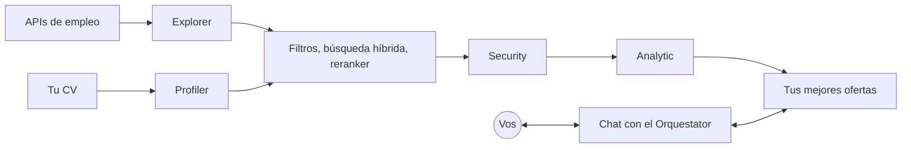

# goop

**Un agente local de búsqueda de empleo para desarrolladores.** goop busca ofertas de trabajo en miles de empresas, las compara con tu CV y te muestra solo las que vale la pena postular. Podés chatear con él mientras sigue buscando en segundo plano. Todo corre en tu computadora, con modelos locales y gratis.

[English](README.md)

> **Estado:** en desarrollo temprano. La base del proyecto está lista; las funcionalidades se están construyendo. Todavía no está listo para usar.

## Por qué

Buscar trabajo lleva horas: recorrer portales, leer ofertas que no encajan, comparar requisitos con tu CV. Los datos de 2026 muestran que pocas postulaciones bien elegidas consiguen más entrevistas por postulación que postularse a todo. goop hace la búsqueda y el filtrado, para que tu tiempo vaya a postularte bien.

## Qué hace

- **Encuentra ofertas** en las APIs públicas de los ATS (Greenhouse, Ashby, Lever) y en agregadores sin clave, descubriendo empresas automáticamente.
- **Las compara con tu CV** con un embudo: filtros rápidos, búsqueda híbrida (embeddings + BM25), un reranker, un filtro contra prompt injection y una evaluación con rúbrica.
- **Explica cada resultado**: puntaje, veredicto, lo que te frena y por qué encaja, con el enlace a la oferta original.
- **Chatea con vos** en una TUI mientras busca, y aprende tus preferencias mediante reglas que vos aprobás.



## Privacidad

Tu CV nunca sale de tu computadora, salvo que elijas explícitamente una API de modelos remota. La base de datos y tus archivos están cifrados, los secretos se filtran antes de llegar a cualquier modelo y el texto de las ofertas se trata siempre como dato no confiable.

## Tecnologías

TypeScript sobre [Bun](https://bun.sh), [OpenTUI](https://opentui.com) con React, [LangGraph](https://langchain-ai.github.io/langgraphjs/), SQLite cifrado con sqlite-vec y FTS5, y modelos locales servidos por [llama.cpp](https://github.com/ggml-org/llama.cpp) a través de [llama-swap](https://github.com/mostlygeek/llama-swap). Linux y Windows; macOS más adelante.

## Desarrollo

```sh
bun install
bun run test
```

El desarrollo queda dentro del repositorio (`.local/` y `.temp/`). Leé [`AGENTS.md`](AGENTS.md) y [`CONTRIBUTING.md`](CONTRIBUTING.md) antes de contribuir.

## Licencia

goop se distribuye bajo la [Licencia Pública General de GNU v3.0](LICENSE) (GPL-3.0-only). Las atribuciones están en [`NOTICE`](NOTICE).
