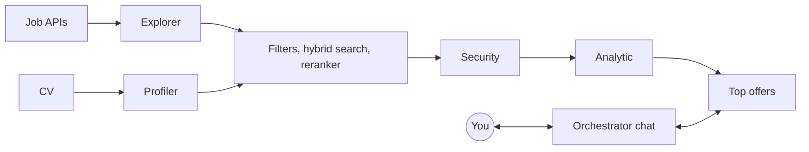

<p align="center"></p>

# goop

**A local job search agent for developers.** · **Un agente local de búsqueda de empleo para desarrolladores.**

> **Status / Estado:** early development / en desarrollo temprano.



<details open>
<summary><b>English</b></summary>

goop finds job offers in thousands of companies, compares them with your CV and shows you only the ones worth applying to. You can chat with it while it keeps searching in the background. Everything runs on your computer, with local models, for free.

The foundation is in place; the features are being built. Nothing here is ready to use yet.

### Why

Searching for a job takes hours: browsing boards, reading offers that do not fit, checking requirements against your CV. Data from 2026 shows that a few well-chosen applications get more interviews per application than applying to everything. goop does the searching and filtering, so your time goes into applying well.

### What it does

- **Finds offers** from public ATS APIs (Greenhouse, Ashby, Lever) and keyless aggregators, discovering companies automatically.
- **Matches them with your CV** through a funnel: fast filters, hybrid search (embeddings + BM25), a reranker, a prompt-injection screen and an evaluation with a scoring rubric.
- **Explains every result**: score, verdict, what holds you back and why it fits, with a link to the original offer.
- **Chats with you** in a TUI while it searches, and learns your preferences through rules you approve.

### Privacy

Your CV never leaves your computer unless you explicitly choose a remote model API. The database and your files are encrypted, secrets are filtered before any model sees them, and offer texts are always treated as untrusted data.

### Built with

TypeScript on [Bun](https://bun.sh), [OpenTUI](https://opentui.com) with React, [LangGraph](https://langchain-ai.github.io/langgraphjs/), encrypted SQLite with sqlite-vec and FTS5, and local models served by [llama.cpp](https://github.com/ggml-org/llama.cpp) through [llama-swap](https://github.com/mostlygeek/llama-swap). Linux and Windows; macOS later.

### Development

```sh
bun install
bun run test
```

Development stays inside the repository (`.local/` and `.temp/`). Read [`AGENTS.md`](AGENTS.md) and [`CONTRIBUTING.md`](CONTRIBUTING.md) before contributing.

### License

goop is licensed under the [GNU General Public License v3.0](LICENSE) (GPL-3.0-only). See [`NOTICE`](NOTICE) for attributions.

</details>

<details>
<summary><b>Español</b></summary>

goop busca ofertas de trabajo en miles de empresas, las compara con tu CV y te muestra solo las que vale la pena postular. Podés chatear con él mientras sigue buscando en segundo plano. Todo corre en tu computadora, con modelos locales y gratis.

La base del proyecto está lista; las funcionalidades se están construyendo. Todavía no está listo para usar.

### Por qué

Buscar trabajo lleva horas: recorrer portales, leer ofertas que no encajan, comparar requisitos con tu CV. Los datos de 2026 muestran que pocas postulaciones bien elegidas consiguen más entrevistas por postulación que postularse a todo. goop hace la búsqueda y el filtrado, para que tu tiempo vaya a postularte bien.

### Qué hace

- **Encuentra ofertas** en las APIs públicas de los ATS (Greenhouse, Ashby, Lever) y en agregadores sin clave, descubriendo empresas automáticamente.
- **Las compara con tu CV** con un embudo: filtros rápidos, búsqueda híbrida (embeddings + BM25), un reranker, un filtro contra prompt injection y una evaluación con rúbrica.
- **Explica cada resultado**: puntaje, veredicto, lo que te frena y por qué encaja, con el enlace a la oferta original.
- **Chatea con vos** en una TUI mientras busca, y aprende tus preferencias mediante reglas que vos aprobás.

### Privacidad

Tu CV nunca sale de tu computadora, salvo que elijas explícitamente una API de modelos remota. La base de datos y tus archivos están cifrados, los secretos se filtran antes de llegar a cualquier modelo y el texto de las ofertas se trata siempre como dato no confiable.

### Tecnologías

TypeScript sobre [Bun](https://bun.sh), [OpenTUI](https://opentui.com) con React, [LangGraph](https://langchain-ai.github.io/langgraphjs/), SQLite cifrado con sqlite-vec y FTS5, y modelos locales servidos por [llama.cpp](https://github.com/ggml-org/llama.cpp) a través de [llama-swap](https://github.com/mostlygeek/llama-swap). Linux y Windows; macOS más adelante.

### Desarrollo

```sh
bun install
bun run test
```

El desarrollo queda dentro del repositorio (`.local/` y `.temp/`). Leé [`AGENTS.md`](AGENTS.md) y [`CONTRIBUTING.md`](CONTRIBUTING.md) antes de contribuir.

### Licencia

goop se distribuye bajo la [Licencia Pública General de GNU v3.0](LICENSE) (GPL-3.0-only). Las atribuciones están en [`NOTICE`](NOTICE).

</details>
