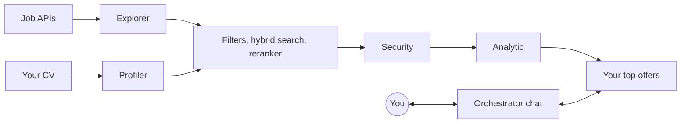

# goop

**A local job search agent for developers.** goop finds job offers in thousands of companies, compares them with your CV and shows you only the ones worth applying to. You can chat with it while it keeps searching in the background. Everything runs on your computer, with local models, for free.

[Español](README.es.md)

> **Status:** early development. The foundation is in place; the features are being built. Nothing here is ready to use yet.

## Why

Searching for a job takes hours: browsing boards, reading offers that do not fit, checking requirements against your CV. Data from 2026 shows that a few well-chosen applications get more interviews per application than applying to everything. goop does the searching and filtering, so your time goes into applying well.

## What it does

- **Finds offers** from public ATS APIs (Greenhouse, Ashby, Lever) and keyless aggregators, discovering companies automatically.
- **Matches them with your CV** through a funnel: fast filters, hybrid search (embeddings + BM25), a reranker, a prompt-injection screen and an evaluation with a scoring rubric.
- **Explains every result**: score, verdict, what holds you back and why it fits, with a link to the original offer.
- **Chats with you** in a TUI while it searches, and learns your preferences through rules you approve.



## Privacy

Your CV never leaves your computer unless you explicitly choose a remote model API. The database and your files are encrypted, secrets are filtered before any model sees them, and offer texts are always treated as untrusted data.

## Built with

TypeScript on [Bun](https://bun.sh), [OpenTUI](https://opentui.com) with React, [LangGraph](https://langchain-ai.github.io/langgraphjs/), encrypted SQLite with sqlite-vec and FTS5, and local models served by [llama.cpp](https://github.com/ggml-org/llama.cpp) through [llama-swap](https://github.com/mostlygeek/llama-swap). Linux and Windows; macOS later.

## Development

```sh
bun install
bun run test
```

Development stays inside the repository (`.local/` and `.temp/`). Read [`AGENTS.md`](AGENTS.md) and [`CONTRIBUTING.md`](CONTRIBUTING.md) before contributing.

## License

goop is licensed under the [GNU General Public License v3.0](LICENSE) (GPL-3.0-only). See [`NOTICE`](NOTICE) for attributions.
