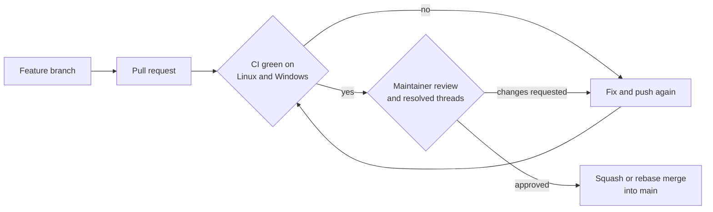

# GitHub repository settings

These settings protect the public repository. They are applied by the maintainer **after** the first publication is reviewed and approved; nothing here runs automatically.

## How a change reaches `main`

## Ruleset for `main`

| Setting                               | Value                                                                                                         |
| ------------------------------------- | ------------------------------------------------------------------------------------------------------------- |
| Require a pull request before merging | On, 1 approval, dismiss stale approvals on new commits                                                        |
| Require status checks                 | `Lint, typecheck and test (ubuntu-latest)` and `Lint, typecheck and test (windows-latest)`, branch up to date |
| Require conversation resolution       | On                                                                                                            |
| Require linear history                | On (squash or rebase merges only)                                                                             |
| Block force pushes                    | On                                                                                                            |
| Restrict deletions                    | On                                                                                                            |
| Bypass list                           | Empty, including administrators                                                                               |

## Security

| Setting                                | Value                                                   |
| -------------------------------------- | ------------------------------------------------------- |
| Private vulnerability reporting        | On (used by `SECURITY.md`)                              |
| Secret scanning and push protection    | On                                                      |
| Dependabot alerts and security updates | On (version updates come from `.github/dependabot.yml`) |
| Code scanning                          | Default setup for JavaScript/TypeScript                 |

## Actions

| Setting                                          | Value                                                                     |
| ------------------------------------------------ | ------------------------------------------------------------------------- |
| Default `GITHUB_TOKEN` permissions               | Read repository contents only                                             |
| Allowed actions                                  | Actions by GitHub, verified creators and the ones pinned in the workflows |
| Fork pull request workflows                      | Require approval for all outside collaborators                            |
| Allow Actions to create or approve pull requests | Off                                                                       |

## General

| Setting                            | Value                                   |
| ---------------------------------- | --------------------------------------- |
| Visibility                         | Public                                  |
| Default branch                     | `main`                                  |
| Merge buttons                      | Squash and rebase on, merge commits off |
| Automatically delete head branches | On                                      |
| Wiki and projects                  | Off (docs live in `docs/`)              |

## Applying them

After the repository is published, the maintainer applies these settings in **Settings** on GitHub, or with the GitHub CLI (`gh repo edit`, `gh api` for rulesets and security features). Re-check this file whenever the CI job names change, because the required status checks refer to them by name.
