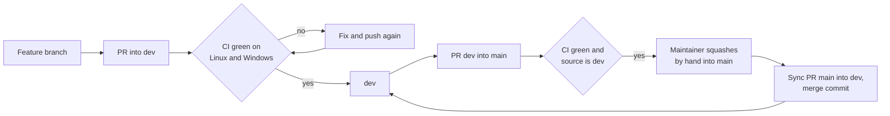

# GitHub repository settings

These settings protect the public repository. They were applied on 2026-11-01, right after the first publication of `ztc0/goop`.

## How a change reaches `main`

## Ruleset "Protect main"

Targets `refs/heads/main` by name. Never target the default branch (`~DEFAULT_BRANCH`): the default branch is `dev`, and a ruleset bound to it would leave `main` unprotected.

| Setting                               | Value                                                                                                                                                                  |
| ------------------------------------- | ---------------------------------------------------------------------------------------------------------------------------------------------------------------------- |
| Require a pull request before merging | On, 0 required approvals (a sole maintainer cannot approve their own pull requests), dismiss stale approvals on new commits; raise to 1 when a second maintainer joins |
| Allowed merge methods                 | Squash only                                                                                                                                                            |
| Require status checks                 | `Lint, typecheck and test (ubuntu-latest)`, `Lint, typecheck and test (windows-latest)` and `Pull request to main comes from dev`, branch up to date                   |
| Require conversation resolution       | On                                                                                                                                                                     |
| Require linear history                | On                                                                                                                                                                     |
| Block force pushes                    | On                                                                                                                                                                     |
| Restrict deletions                    | On                                                                                                                                                                     |
| Bypass list                           | Empty, including administrators                                                                                                                                        |

Only the maintainer merges into `main`, by hand. GitHub cannot tell a person from a tool using the same account, so this is a project rule (see `docs/development/rules/commits.md`), backed by the source-branch check and the absence of auto-merge. The source-branch check lives in `.github/workflows/ci.yml`, which `dev` can change, so a workflow change in a release pull request must be read before merging it.

## Ruleset "Protect dev"

| Setting                               | Value                                                                                      |
| ------------------------------------- | ------------------------------------------------------------------------------------------ |
| Require a pull request before merging | On, 0 required approvals                                                                   |
| Allowed merge methods                 | Merge commit, squash and rebase                                                            |
| Require status checks                 | `Lint, typecheck and test (ubuntu-latest)` and `Lint, typecheck and test (windows-latest)` |
| Block force pushes                    | On                                                                                         |
| Restrict deletions                    | On                                                                                         |
| Bypass list                           | Empty                                                                                      |

## Security

| Setting                                | Value                                                   |
| -------------------------------------- | ------------------------------------------------------- |
| Private vulnerability reporting        | On (used by `SECURITY.md`)                              |
| Secret scanning and push protection    | On                                                      |
| Dependabot alerts and security updates | On (version updates come from `.github/dependabot.yml`) |
| Code scanning                          | CodeQL default setup                                    |

## Actions

| Setting                                          | Value                                          |
| ------------------------------------------------ | ---------------------------------------------- |
| Default `GITHUB_TOKEN` permissions               | Read repository contents only                  |
| Fork pull request workflows                      | Require approval for all outside collaborators |
| Allow Actions to create or approve pull requests | Off                                            |

## General

| Setting                            | Value                                                                                            |
| ---------------------------------- | ------------------------------------------------------------------------------------------------ |
| Visibility                         | Public                                                                                           |
| Default branch                     | `dev` (new pull requests target it)                                                              |
| Merge buttons                      | Merge commit, squash and rebase enabled; each ruleset restricts its branch (`main`: squash only) |
| Automatically delete head branches | On (feature branches; `dev` is protected from deletion)                                          |
| Wiki and projects                  | Off (docs live in `docs/`)                                                                       |

## Keeping them in sync

The settings were applied with the GitHub CLI (`gh repo edit`, and `gh api` for the "Protect main" and "Protect dev" rulesets and the security features). Re-check this file whenever the CI job names change, because the required status checks refer to them by name.
