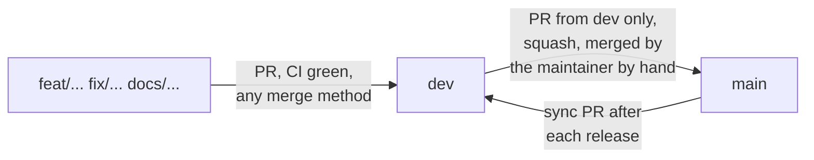

# Commit and review rules

## Messages

Conventional Commits, checked by commitlint in the `commit-msg` hook:

```text
type(scope): subject in the imperative
```

Types: `feat`, `fix`, `docs`, `test`, `refactor`, `perf`, `build`, `ci`, `chore`, `revert`. The scope is the feature folder when there is one (`feat(offers): add the Greenhouse connector`).

## Hooks

`pre-commit` runs Biome on staged files, the typecheck and the test suite. Do not bypass hooks with `--no-verify`.

## Work units

- Work on a feature branch created from `dev` (`feat/...`, `fix/...`, `docs/...`), never directly on `dev` or `main`.
- Commit in reviewable slices of about 400 authored changed lines; tests and docs go in the same commit as the behavior they cover.
- A change that touches security, stored data or delivery gets its own commit.
- Record the commit of each task in the plan (`odd/tasks/goop.md`).

## Branch flow



- **`dev`** is the integration branch and the default branch. Feature pull requests target it; any merge method is allowed (merge commit, squash or rebase).
- **`main`** only accepts pull requests whose head is `dev` (a CI check rejects any other source). Each release lands as **one squashed commit** titled with the pull request title, which must be a Conventional Commit.
- **Only the maintainer merges into `main`, by hand.** Coding agents may open the `dev` -> `main` pull request but never merge it.
- After a release is squashed into `main`, open a sync pull request from `main` into `dev` and merge it with a merge commit, so the two branches do not diverge.

## Publishing

Agents push feature branches and open pull requests into `dev` as part of authorized work. Merging into `main`, tags and releases are the maintainer's decision.
