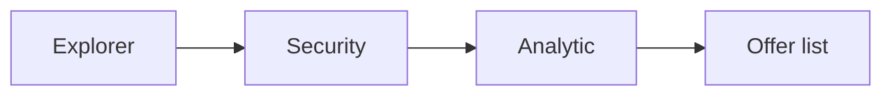

# Documentation rules

## Flows are Mermaid

Every flow, sequence, state machine or architecture diagram in `docs/` is a Mermaid diagram in a fenced `mermaid` block. No images of diagrams, no ASCII art for flows.

## Where docs go

| Folder               | For          | Contains                                                       |
| -------------------- | ------------ | -------------------------------------------------------------- |
| `docs/product/`      | Anyone       | Vision, MVP scope, requirements, roadmap                       |
| `docs/architecture/` | Developers   | How goop is built                                              |
| `docs/adr/`          | Developers   | One numbered decision per file                                 |
| `docs/guides/`       | Users        | Installation, first run, usage, configuration, troubleshooting |
| `docs/development/`  | Contributors | Setup, testing, evaluation, quantization, release, these rules |
| `docs/research/`     | Anyone       | Research notes with their sources                              |

Prompts are not docs: they live in `prompts/`. Visual designs live in `design/`.

## ADRs

File name `NNNN-short-title.md`, with four sections: Context, Options, Decision, Consequences. An ADR is never rewritten; a new ADR supersedes it.

## Style

English, short sentences, one idea per paragraph. Link to sources in research notes. Update the docs and help text in the same commit as the behavior they describe.
