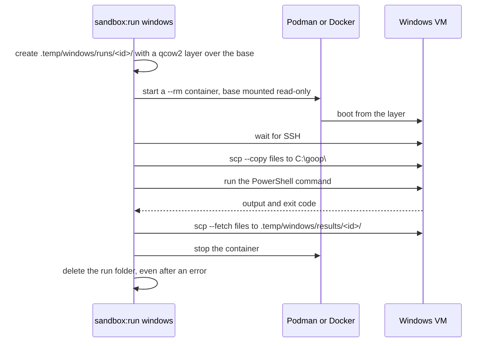
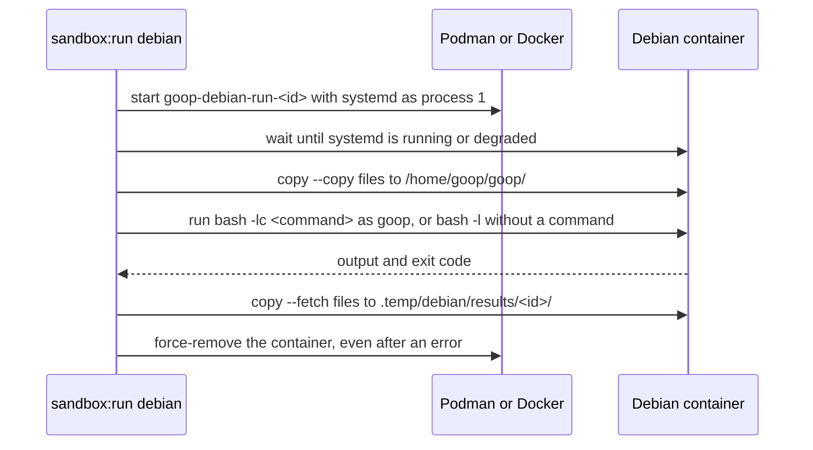

# Sandbox: throwaway Windows and Debian machines

goop ships for Linux and Windows. Some checks only mean something on a real system: native DLLs, file paths and the compiled `.exe` on Windows; systemd units, timers and user services on Linux. `scripts/sandbox/` runs them in throwaway machines:
- `windows`: a Windows 11 virtual machine, run by QEMU inside a container.
- `debian`: a Debian 13 container with systemd as process 1 and a non-root user `goop`.

Each run starts clean, runs one command, brings the requested files back and deletes the machine. Nothing is installed on the host: the tool runs in containers, and every file it writes stays under `.local/` and `.temp/`. The one exception is Docker's own image store when Docker is the engine (see [Engines](#engines)).

## Requirements

- A container engine: Podman (rootless, recommended) or Docker. Root is not needed with Podman.
- For `windows` only:
  - Linux with KVM: `/dev/kvm` must be readable and writable by your user.
  - `ssh`, `scp` and `ssh-keygen`.
  - About 10 GiB free for the Windows base and 6 GB more while it installs.

A host QEMU is not needed.

## Commands

The system is the word right after the command: `windows` or `debian`.

| Command                           | What it does                                                                                                |
| --------------------------------- | ----------------------------------------------------------------------------------------------------------- |
| `bun run sandbox:install windows` | Installs Windows once into `.local/windows/base/`; about 25 minutes the first time (13 on the measured run) |
| `bun run sandbox:install debian`  | Builds the Debian image; run it again to rebuild after the Containerfile changes                            |
| `bun run sandbox:run windows`     | Boots a throwaway VM over the base, runs one PowerShell command, deletes the VM                             |
| `bun run sandbox:run debian`      | Starts a throwaway container, runs one shell command as `goop`, deletes the container                       |
| `bun run sandbox:status windows`  | Shows the base and its size, and any VM still running                                                       |
| `bun run sandbox:status debian`   | Shows the Debian image and its size, and any container still running                                        |
| `bun run sandbox:test windows`    | Runs the whole test suite in a throwaway VM on a copy of the repo (see [The whole suite](#the-whole-suite)) |
| `bun run sandbox:test debian`     | Runs the whole test suite in a throwaway container, on a copy of the repo                                   |

`sandbox:run` takes the system first, then the options, then the command:

```sh
bun run sandbox:run debian uname -a
bun run sandbox:run debian 'systemctl --version; systemctl --user is-system-running'
bun run sandbox:run debian --copy dist --fetch /home/goop/goop/out.txt -- 'ls -l dist > out.txt'

bun run sandbox:run windows 'Get-ComputerInfo | Select-Object OsName; exit 3'

bun run sandbox:run windows --copy .local/build/sqlite/windows/goop-spike-check.exe \
  --fetch 'C:\goop\result.txt' -- \
  '& C:\goop\goop-spike-check.exe 2>&1 | Tee-Object -FilePath C:\goop\result.txt; exit $LASTEXITCODE'
```

- `--copy <repo path>` uploads a file or folder from the repo before the command: to `C:\goop\` on Windows, to `/home/goop/goop/` on Debian (owned by `goop`). Paths outside the repo are refused. It can be repeated.
- `--fetch <path>` downloads a file after the command, to `.temp/windows/results/<run id>/` or `.temp/debian/results/<run id>/`. It must be an absolute path without spaces or quotes: `C:\goop\out.xml` on Windows, `/home/goop/goop/out.txt` on Debian. A failed fetch turns a successful run into exit code 1. It can be repeated.
- `--engine podman|docker` picks the engine (see [Engines](#engines)). `install` and `status` take it too.
- The exit code of the command becomes the exit code of `sandbox:run`. Ctrl+C stops the run with exit code 130 and still cleans up.
- The `--` before the command is optional: the command starts at the first word that is not an option. Write it when the command itself starts with `--`.

On Debian, the command runs with `bash -lc` as `goop` in `/home/goop/goop/`, and `systemctl --user` works because goop's user manager starts at boot. Without a command, `bun run sandbox:run debian` opens a login shell as `goop` in a fresh container; `exit` leaves it and deletes the container. The shell needs a terminal: without one, the run stops with exit code 2 and asks for a command.

On Windows, while a VM runs, its screen is visible in a browser at `http://127.0.0.1:8006`. SSH listens on `127.0.0.1:2222`. Both bind to loopback only.

## The whole suite

`sandbox:test <system>` runs `bun run test` in a throwaway sandbox, so the suite runs on Windows and on Debian, not only on the host. It takes `--engine` and no command; its exit code is the suite's exit code.

```sh
bun run sandbox:test windows
bun run sandbox:test debian
```

1. It checks that the Windows base or the Debian image exists, and that `package.json` pins the Bun the sandbox has hashes for (`"packageManager": "bun@1.4.2"`). Otherwise it stops before downloading anything.
2. It takes Bun from `.local/cache/sandbox-bun/<version>-<hash>/` when the executable there still has its pinned sha256. Otherwise it downloads the release zip (`bun-windows-x64.zip` or `bun-linux-x64.zip`) and the release's `SHASUMS256.txt` from `github.com/oven-sh/bun` into a fresh folder under `.temp/downloads/`. The zip must be listed in `SHASUMS256.txt` with the sha256 pinned in `scripts/sandbox/model/bun-release.ts`, and must have it; the executable inside must have its own pinned sha256. Only then is the executable cached. Nothing from the download runs on the host.
3. It copies the repo into `.temp/sandbox-test/<run id>/repo/`: the files `git ls-files --cached --others --exclude-standard` lists, so uncommitted work is tested too and `.local/`, `.temp/` and `node_modules/` never are. An empty `.git` folder marks the copy's root for tools that look for it (commitlint); no git history is copied.
4. It uploads the copy and Bun (to `C:\goop\repo` and `C:\goop\bun` on Windows, to `/home/goop/goop/` on Debian), puts that Bun first on `PATH`, and runs `bun install --frozen-lockfile` and `bun run test` there (PowerShell on Windows, `bash` as `goop` on Debian). The sandbox is deleted and the copy removed when the run ends.

`bun install` downloads the dependencies from the npm registry inside the sandbox: both the Windows VM and the Debian container reach the network. The Debian image has `git` (pinned) because commitlint calls `git config`.

The native library is not copied in, so its integration tests skip in the sandbox (20 tests; the build of the library is being redone, see `odd/tasks/storage.md` L39). Linux in a VM (a Debian VM with a software TPM) comes with sandbox T7; until then the Linux suite runs in the container only.

## How a run works

### Windows

Windows is installed once. Each run starts from that base on a new, empty disk layer, and the layer is deleted when the run ends. Every run starts clean, and the base never changes.



The install works the same way, once. The `dockurr/windows` image downloads the Windows 11 Enterprise LTSC evaluation ISO and installs it unattended. A setup script then turns on OpenSSH, adds the repo's SSH key, and writes `C:\OEM\ready.txt`. When that marker exists, the install stops Windows and keeps the disk as the base.

### Debian

`sandbox:install debian` builds `scripts/sandbox/debian/Containerfile` into the image `localhost/goop-sandbox-debian:2`. The image is Debian 13 (`debian:trixie`, pinned by digest) with systemd, dbus, git and the user `goop` (UID 1000), whose user manager starts at boot. Only the Containerfile's folder is sent to the build.



If the container cannot be removed, the run prints the command that removes it by hand and turns exit code 0 into 1.

## Where the files live

| Path                                   | Contents                                                                   |
| -------------------------------------- | -------------------------------------------------------------------------- |
| `.local/windows/base/`                 | The installed Windows disk (`data.qcow2`) and its UEFI files               |
| `.local/windows/ssh/`                  | The SSH key pair for the guest (mode 0600)                                 |
| `.local/windows/password`              | The random guest password (mode 0600)                                      |
| `.local/containers/storage/`           | Podman's images and containers, `localhost/goop-sandbox-debian:2`          |
| `.local/cache/sandbox-bun/`            | The verified Bun executables of `sandbox:test`, by version and hash        |
| `.temp/downloads/bun-*/`               | A downloaded Bun zip, kept after its sha256 check                          |
| `.temp/sandbox-test/<id>/`             | The repo copy and Bun of one `sandbox:test` run; deleted when it ends      |
| `.temp/windows/runs/<id>/`             | The disk layer of one run; deleted when the run ends                       |
| `.temp/windows/results/`               | Files brought back with `--fetch` from Windows                             |
| `.temp/debian/results/`                | Files brought back with `--fetch` from Debian                              |
| `.temp/containers/`                    | Podman's runtime and temporary files                                       |
| `scripts/sandbox/debian/Containerfile` | The Debian image; bump the tag in `model/debian-config.ts` when it changes |

`bun run clean` deletes `.temp/`, which removes results but keeps the base and the image. `bun run clean:local` deletes the base and Podman's storage, and the next run needs a new install.

To call Podman by hand, pass the same storage with absolute paths. Relative paths fail with `database configuration mismatch`.

```sh
podman --root "$PWD/.local/containers/storage" --runroot "$PWD/.temp/containers/run" \
  --tmpdir "$PWD/.temp/containers/tmp" ps
```

## Engines

The engine is chosen in this order:
1. `--engine docker|podman`, if given; it stops with an error when that engine is not installed.
2. Podman, if it is installed. It keeps every image and container under `.local/` and leaves no root-owned files.
3. Docker, if it is the only one. It prints a warning: its images and containers live in Docker's own storage (usually `/var/lib/docker`), outside this repository. `bun run clean:local` does not remove them.
4. Otherwise it stops with "No container engine found. Install Podman (recommended) or Docker."

Both engines sit behind one `ContainerEngine` interface (`types/sandbox.ts`), with an adapter each in `adapters/`. The choice is the pure function `chooseEngine` in `model/engine-choice.ts`.

Podman starts the Debian container with `--systemd=always`, which mounts `/run`, `/tmp` and the cgroups systemd needs. Docker has no such flag, so the Docker adapter starts it with:

```sh
--cgroupns=host -v /sys/fs/cgroup:/sys/fs/cgroup:rw \
  --tmpfs /run --tmpfs /run/lock --tmpfs /tmp:exec --env container=docker
```

This avoids `--privileged`, but it shares the host's cgroup namespace and mounts the host's cgroup tree writable: a process in the sandbox can change the host's cgroup tree. That is fine on a throwaway CI runner. On a developer PC with Docker, it is more privilege than Podman needs; prefer Podman there. A narrower set (for example `--cgroupns=private` with `--cap-add SYS_ADMIN`) is still to be tried.

The CI job "Sandbox: Debian on Docker" (`.github/workflows/ci.yml`, not a required check) installs the Debian image with Docker, runs it and checks that the user manager is running.

## Known limits

- Windows: the guest is an evaluation build. It reports "Windows License is expired". It is fine for short test runs and must not be used for anything else.
- Windows: the cleanup after Ctrl+C is tested with fakes only; a real interrupted run has not been tried. On Debian, a real Ctrl+C removed the container.
- Windows: the first install's `Set-ExecutionPolicy` step failed on this image; it is now tolerated (see the log of [`odd/tasks/windows-vm.md`](../../odd/tasks/windows-vm.md)).
- Windows on Docker: the arguments are built and unit-tested, but it has never run.
- Debian: a container shares the host's kernel and has no TPM, so it cannot test TPM2, a kernel of its own or reboots. A Debian VM for those is deferred (S5 in [`odd/tasks/sandbox.md`](../../odd/tasks/sandbox.md)).
- Debian: the base image is pinned by digest, but the apt packages installed on top of it are not pinned, except `git`.
- Linux in a VM: not yet; the Debian VM with a software TPM comes with sandbox T7.

## How `scripts/` is organized

`scripts/` follows the same architecture as `src/`: one folder per feature, named after what it does.

| Folder             | What it is for                                                                                  |
| ------------------ | ----------------------------------------------------------------------------------------------- |
| `scripts/dev-env/` | `run.ts` (the repo-local environment for every package script) and `clean.ts`                   |
| `scripts/brand/`   | `logo-assets.ts`, which builds the logo files                                                   |
| `scripts/sandbox/` | The sandbox: `cli.ts` plus `types/`, `model/`, `services/`, `adapters/`, `debian/` and `tests/` |
| `scripts/shared/`  | Code used by more than one script folder: `repo-root.ts`, `download.ts` (https and sha256)      |

Inside a feature folder, `types/` holds the interfaces, `model/` the pure logic, `services/` the steps in order, and `adapters/` the I/O (processes, files, clock). Tests use fake adapters, so they never start Podman, Docker, Windows or Debian. The rules are in [`rules/architecture.md`](rules/architecture.md).

Inside `scripts/sandbox/`:

| Path                     | What it is for                                                                                    |
| ------------------------ | ------------------------------------------------------------------------------------------------- |
| `cli.ts`                 | Parses the command line, picks the engine and calls the service for the system                    |
| `model/cli-args.ts`      | The command line and the usage text                                                               |
| `model/engine-choice.ts` | The engine order above                                                                            |
| `model/podman-args.ts`   | The Podman arguments, with the repo-local storage flags                                           |
| `model/docker-args.ts`   | The Docker arguments that differ from Podman's, such as the systemd flags                         |
| `model/debian-config.ts` | The Debian image tag, user, folders and readiness check                                           |
| `model/vm-config.ts`     | The `dockurr/windows` image, ports and Windows names                                              |
| `model/bun-release.ts`   | The pinned Bun release: URLs, the zip and executable sha256 values, the cache folder              |
| `model/suite.ts`         | One suite plan per system (Bun build, shell, upload folder), the suite command, the repo copy     |
| `model/zip.ts`           | Reads one named file out of a zip, after its sha256 check                                         |
| `services/`              | `install.ts`, `run.ts`, `status.ts` for Windows, `debian.ts` for Debian, `suite.ts` for `test`    |
| `adapters/`              | `podman.ts` and `docker.ts` (the `ContainerEngine` adapters), the guest SSH shell, files, process |
| `debian/Containerfile`   | The Debian image                                                                                  |
| `tests/`                 | Unit tests of the pure logic and integration tests of the CLI with fake programs                  |
