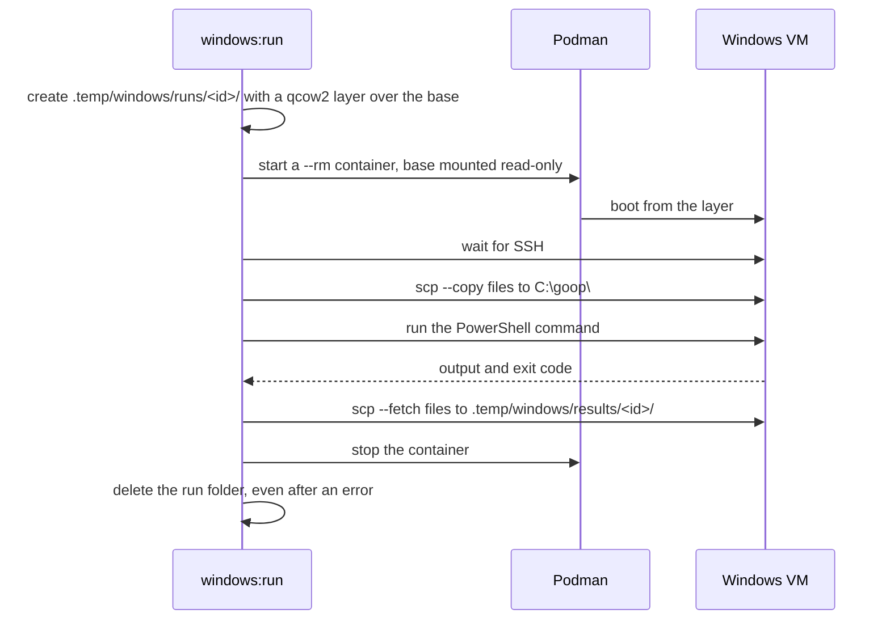

# Windows test VM

goop ships for Linux and Windows. Some checks only mean something on real Windows, such as native DLLs, file paths and the compiled `.exe`. `scripts/windows-vm/` runs them on a Windows 11 virtual machine. The VM runs inside a rootless Podman container, so nothing is installed on the host, and every file stays inside the repo.

## Requirements

- Linux with KVM: `/dev/kvm` must be readable and writable by your user.
- Podman (rootless), `ssh`, `scp` and `ssh-keygen`.
- About 10 GiB free for the Windows base and 6 GB more while it installs.

Docker, a host QEMU and root are not needed.

## Commands

| Command                   | What it does                                                                         |
| ------------------------- | ------------------------------------------------------------------------------------ |
| `bun run windows:install` | Installs Windows once into `.local/windows/base/`; about 13 minutes on the first run |
| `bun run windows:run`     | Boots a throwaway VM over the base, runs one PowerShell command, deletes the VM      |
| `bun run windows:status`  | Shows the base and its size, and any VM still running                                |

`windows:run` takes options first, then the command:

```sh
bun run windows:run -- 'Get-ComputerInfo | Select-Object OsName; exit 3'

bun run windows:run -- --copy .local/build/sqlite/windows/goop-spike-check.exe \
  --fetch 'C:\goop\result.txt' -- \
  '& C:\goop\goop-spike-check.exe 2>&1 | Tee-Object -FilePath C:\goop\result.txt; exit $LASTEXITCODE'
```

- `--copy <repo path>` uploads a file or folder from the repo to `C:\goop\` before the command. Paths outside the repo are refused.
- `--fetch <guest path>` downloads a file to `.temp/windows/results/<run id>/` after the command. It must be an absolute path without spaces or quotes. A failed fetch turns a successful run into exit code 1.
- The exit code of the PowerShell command becomes the exit code of `windows:run`.
- `bun run` drops the first `--`, so the command after the options also works without it.

While a VM runs, its screen is visible in a browser at `http://127.0.0.1:8006`. SSH listens on `127.0.0.1:2222`. Both bind to loopback only.

## How a run works

Windows is installed once. Each run starts from that base on a new, empty disk layer, and the layer is deleted when the run ends. Every run starts clean, and the base never changes.



The install works the same way, once. The `dockurr/windows` image downloads the Windows 11 Enterprise LTSC evaluation ISO and installs it unattended. A setup script then turns on OpenSSH, adds the repo's SSH key, and writes `C:\OEM\ready.txt`. When that marker exists, the install stops Windows and keeps the disk as the base.

## Where the files live

| Path                         | Contents                                                     |
| ---------------------------- | ------------------------------------------------------------ |
| `.local/windows/base/`       | The installed Windows disk (`data.qcow2`) and its UEFI files |
| `.local/windows/ssh/`        | The SSH key pair for the guest (mode 0600)                   |
| `.local/windows/password`    | The random guest password (mode 0600)                        |
| `.local/containers/storage/` | Podman's images and containers                               |
| `.temp/windows/runs/<id>/`   | The disk layer of one run; deleted when the run ends         |
| `.temp/windows/results/`     | Files brought back with `--fetch`                            |
| `.temp/containers/`          | Podman's runtime and temporary files                         |

`bun run clean` deletes `.temp/`, which removes results but keeps the base. `bun run clean:local` deletes the base, and the next run needs a new install.

To call Podman by hand, pass the same storage with absolute paths. Relative paths fail with `database configuration mismatch`.

```sh
podman --root "$PWD/.local/containers/storage" --runroot "$PWD/.temp/containers/run" \
  --tmpdir "$PWD/.temp/containers/tmp" ps
```

## Known limits

- The guest is an evaluation build. It reports "Windows License is expired". It is fine for short test runs and must not be used for anything else.
- The cleanup after Ctrl+C is tested with fakes only; a real interrupted run has not been tried.
- The first install's `Set-ExecutionPolicy` step failed on this image; it is now tolerated (see the log of [`odd/tasks/windows-vm.md`](../../odd/tasks/windows-vm.md)).

## How `scripts/` is organized

`scripts/` follows the same architecture as `src/`: one folder per feature, named after what it does.

| Folder                | What it is for                                                                       |
| --------------------- | ------------------------------------------------------------------------------------ |
| `scripts/dev-env/`    | `run.ts` (the repo-local environment for every package script) and `clean.ts`        |
| `scripts/brand/`      | `logo-assets.ts`, which builds the logo files                                        |
| `scripts/windows-vm/` | The Windows VM: `cli.ts` plus `types/`, `model/`, `services/`, `adapters/`, `tests/` |
| `scripts/shared/`     | Code used by more than one script folder, such as `repo-root.ts`                     |

Inside a feature folder, `types/` holds the interfaces, `model/` the pure logic, `services/` the steps in order, and `adapters/` the I/O (processes, files, clock). Tests use fake adapters, so they never start Podman or Windows. The rules are in [`rules/architecture.md`](rules/architecture.md).
