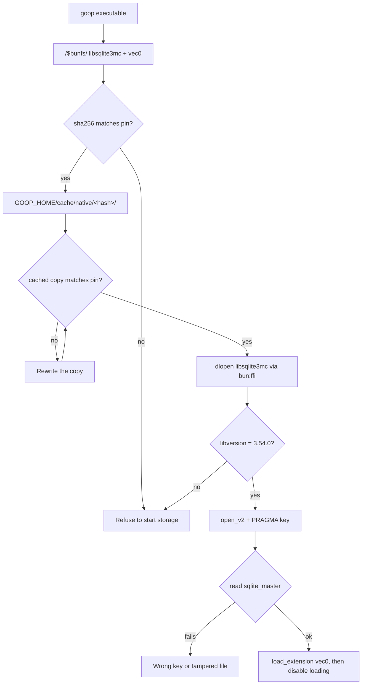

# Spike: encrypted SQLite with FTS5 and sqlite-vec in Bun (T10)

Date: 2026-11-01. Task T10 in [`odd/tasks/goop.md`](../../odd/tasks/goop.md), specs S12, S17 and S24. Linux x86_64 and Windows 11 x64 were run (Windows through `bun run windows:run`, task T4 of [`odd/tasks/windows-vm.md`](../../odd/tasks/windows-vm.md)).

## Question

Can goop keep one encrypted SQLite database (SQLite3MultipleCiphers) with FTS5 and sqlite-vec, opened from Bun, inside the single `bun build --compile` executable, on Linux and Windows?

## Short answer

Yes, but not through `bun:sqlite`. On Linux, sqlite3mc built as a shared library and driven through `bun:ffi` passed every check, both from source and from the compiled executable. On Windows 11, the official `sqlite3mc_x64.dll` and `vec0.dll`, embedded in an executable cross-compiled on Linux, passed the same checks. FTS5 and vec0 worked on the encrypted database, a wrong key could not read it, the file showed no plaintext, the cipher was ChaCha20, and `bun:sqlite` ran side by side without a clash.

One trap was found: `vec0.so` must never be loaded into both SQLite copies in the same process. Doing so crashed Bun with `SIGSEGV`.

## Findings

1. **`bun:sqlite` cannot be the encrypted store on Linux or Windows.** Bun links its SQLite statically, and `Database.setCustomSQLite()` works only on macOS ([Bun SQLite docs](https://bun.com/docs/runtime/sqlite)). The Bun 1.4.2 binary exports no `sqlite3_*` symbols (`nm -D --defined-only` found 0), so nothing can be swapped in.
2. **sqlite3mc replaces SQLite; it is not an extension** ([issue #64](https://github.com/utelle/SQLite3MultipleCiphers/issues/64)). So it must be a second SQLite copy in the process, loaded with `bun:ffi` ([Bun FFI docs](https://bun.com/docs/runtime/ffi)).
3. **The dispatch table hides that second copy.** With `SQLITE3MC_USE_DISPATCH_TABLE`, every SQLite function becomes `static`. The library then exports only three pointers to function tables: `sqlite3mc_api_ext` (the `sqlite3_api_routines` layout from `sqlite3ext.h`), `sqlite3mc_api_core` and `sqlite3mc_api_mc` (comment and code in `sqlite3mc_amalgamation.c` 2.6.1). The built `.so` exports 15 dynamic symbols and none of them is `sqlite3_*`.
4. **bun:ffi can read those tables.** `dlopen` a data symbol without calling it, take its `.ptr`, `read.ptr()` the table, then wrap each slot with `CFunction`. The slot numbers come from the C compiler (`offsetof(sqlite3_api_routines, f) / sizeof(void*)`), for example `open_v2` = 135 and `load_extension` = 196. `enable_load_extension` is not in `sqlite3_api_routines`; it is slot 3 of `sqlite3mc_core_routines`. The wrapper checks `libversion()` = `3.54.0` at load time, as a guard against a wrong slot.
5. **The amalgamation keeps temp data in memory.** It defaults to `SQLITE_TEMP_STORE=2` because temporary files are not encrypted (header comment of `sqlite3mc_amalgamation.c`).
6. **A wrong key still returns ok from `PRAGMA key`.** The first real read fails with `file is not a database (rc 26)`. The key has to be verified with a read of `sqlite_master`, as the research predicted.
7. **sqlite-vec loads through the API pointer, not through symbols.** `vec0.so` has no undefined `sqlite3_*` symbols, so it binds to whichever SQLite calls `sqlite3_vec_init`. It keeps that pointer in one global, so a second load into another SQLite copy redirects the first copy's calls (item g below).
8. **`bun build --compile` embeds `.so` files with `with { type: "file" }`.** They appear as `/$bunfs/root/libsqlite3mc-a8hdbp6m.so` and `/$bunfs/root/vec0-6zn72t7p.so` ([Bun executables docs](https://bun.com/docs/bundler/executables)). `dlopen` cannot read `/$bunfs/`. Copying them to a cache folder, checking their sha256 and loading the copy works.
9. **sqlite3mc 2.6.1 ships Cosign-signed `SHA256SUMS`** ([release v2.6.1](https://github.com/utelle/SQLite3MultipleCiphers/releases/tag/v2.6.1)). **sqlite-vec v0.1.9 publishes `checksums.txt`** ([release v0.1.9](https://github.com/asg017/sqlite-vec/releases/tag/v0.1.9)). The GitHub API `digest` field of each asset matched both files.
10. **The official Windows DLL works.** `sqlite3mc_x64.dll` exports the plain `sqlite3_*` names, including `sqlite3_open_v2`, `sqlite3_key`, `sqlite3_load_extension` and `sqlite3_enable_load_extension`, and the wrapper's `exports` mode loads it by name. It imports only `KERNEL32.dll`, and so does `vec0.dll` (`objdump -p`), so no VC++ runtime is needed. On Windows 11, `PRAGMA compile_options` returned 57 options, including `ENABLE_FTS5`, `THREADSAFE=1` and `TEMP_STORE=2`.
11. **Bun cross-compiles the Windows executable on Linux.** `bun build --compile --target=bun-windows-x64` downloaded the `bun-windows-x64-v1.4.2` runtime into `.local/cache/bun` and finished in 1.6 s. The embedded DLLs appear as `B:/~BUN/root/sqlite3mc_x64-e2w1m9md.dll` and `B:/~BUN/root/vec0-4yhps9z1.dll`.

## Artifacts

| Artifact                                                | sha256                                                             | Verification                                                       |
| ------------------------------------------------------- | ------------------------------------------------------------------ | ------------------------------------------------------------------ |
| `sqlite3mc-2.6.1-sqlite-3.54.0-amalgamation.zip`        | `3f25af603566a23c821d8e581778b5ece2a541d2435776de57b8d845c176815a` | Matches `sqlite3mc-2.6.1-SHA256SUMS`; Cosign signature NOT checked |
| `sqlite3mc-2.6.1-SHA256SUMS`                            | `45724e1719a4ad924ddb5b65ac76cde9d6fb2d3f1f1bf91956b4088d2712e6b5` | Matches the GitHub asset digest only; `.sig` / `.pem` not checked  |
| `sqlite-vec-0.1.9-loadable-linux-x86_64.tar.gz`         | `b959baa1d8dc88861b1edb337b8587178cdcb12d60b4998f9d10b6a82052d5d7` | Matches `checksums.txt` (no signature published)                   |
| `vec0.so` (inside the archive above)                    | `5923730861b86c707cca5602b5f91092f9e52a46706dbc6e269fd4bb9c4498e8` | Pinned in `check.ts`                                               |
| `checksums.txt` (sqlite-vec)                            | `d769550da143ea7995aaaa9253b912ae1c96670460a5f798a569a9ee1af6b423` | Matches the GitHub asset digest only                               |
| `libsqlite3mc.so` (local build, gcc 16.2.1, glibc 2.44) | `5ed60d03de21885795e111d82b71f0f667ac8e00059eec10cce305d05caf6aad` | Built here; not reproducible across compilers                      |
| `sqlite3mc-2.6.1-sqlite-3.54.0-win64.zip`               | `0183b85d2abc9e3418abd92736cb71355b2bc933f6cda6b56f91653e6628cd74` | Matches `SHA256SUMS`; pinned in `build-artifacts.ts`               |
| `sqlite3mc_x64.dll` (`dll/` inside the archive above)   | `683927db7e16cca301c5f2a236830de28c26b47f01d948f6abf2f0d60776ce4d` | Pinned in `check-windows.ts`; run on Windows 11                    |
| `sqlite-vec-0.1.9-loadable-windows-x86_64.tar.gz`       | `51581189d52066b4dfc6631f6d7a3eab7dedc2260656ab09ca97ab3fb8165983` | Matches `checksums.txt`; pinned in `build-artifacts.ts`            |
| `vec0.dll` (inside the archive above)                   | `fcf98662a7ad9dce394b96a88f91032047823831b951c76636787c312a6476e6` | Pinned in `check-windows.ts`; run on Windows 11                    |
| `goop-spike-check.exe` (cross-compiled, Bun 1.4.2)      | `28e09f955ed5677b31d3b9967de26996497b88a812cb0031b1f93fa2b2389d14` | Built here; the hash of the run below                              |

## Spike code

It was spike code, not product code. It was removed from the repository after the spike and can be read in git history at commit `03507e4`, path `scripts/spikes/encrypted-sqlite/`, for example `git show 03507e4:scripts/spikes/encrypted-sqlite/sqlite3mc.ts`. The commands below ran against that code.

| File                 | Role                                                                                                                                                                                                                               |
| -------------------- | ---------------------------------------------------------------------------------------------------------------------------------------------------------------------------------------------------------------------------------- |
| `build-artifacts.ts` | Downloads the pinned archives, checks sha256, rejects unsafe archive paths, extracts each into a fresh folder; `linux` (default) compiles `libsqlite3mc.so`, `windows` takes the official DLLs into `.local/build/sqlite/windows/` |
| `sqlite3mc.ts`       | The `bun:ffi` wrapper: dispatch-table mode (Linux build) and plain-exports mode (Windows DLL)                                                                                                                                      |
| `native-cache.ts`    | Picks the cache folder (`GOOP_SPIKE_CACHE`, `GOOP_HOME`, `%LOCALAPPDATA%`), copies an embedded library to `<cache>/<hash prefix>/<name>`, checks sha256 before and after the copy                                                  |
| `checks.ts`          | Runs checks a-f and h, prints PASS/FAIL, exits 1 on any FAIL; runs probe g in a child process                                                                                                                                      |
| `check.ts`           | Linux entry: embeds `libsqlite3mc.so` and `vec0.so`, uses dispatch-table mode                                                                                                                                                      |
| `check-windows.ts`   | Windows entry: embeds `sqlite3mc_x64.dll` and `vec0.dll`, uses exports mode                                                                                                                                                        |
| `native-files.d.ts`  | Module types for `.so`, `.dll` and `.sha256` file imports                                                                                                                                                                          |

## Commands

Run from the repository root. `scripts/dev-env/run.ts` sets `GOOP_HOME=.local/` and `TMPDIR=.temp/tmp/`.

```sh
# Download, verify, extract and build into .local/build/sqlite/
bun scripts/dev-env/run.ts bun scripts/spikes/encrypted-sqlite/build-artifacts.ts

# The compile step inside build-artifacts.ts
gcc -O2 -fPIC -shared -DSQLITE_ENABLE_FTS5 -DSQLITE3MC_USE_DISPATCH_TABLE -DSQLITE_THREADSAFE=1 \
  -o .local/build/sqlite/libsqlite3mc.so .temp/extract/sqlite3mc-2.6.1-<random>/sqlite3mc_amalgamation.c -lm -lpthread

# Checks from source
bun scripts/dev-env/run.ts bun scripts/spikes/encrypted-sqlite/check.ts

# Compiled executable, run against an empty cache so the copy out of /$bunfs/ is exercised
bun scripts/dev-env/run.ts bun build --compile scripts/spikes/encrypted-sqlite/check.ts \
  --outfile .local/build/sqlite/goop-spike-check
GOOP_SPIKE_CACHE=$PWD/.temp/scratch/compiled-cache bun scripts/dev-env/run.ts .local/build/sqlite/goop-spike-check

# Windows: fetch and verify the official DLLs, cross-compile, run in a throwaway Windows 11 VM
bun scripts/dev-env/run.ts bun scripts/spikes/encrypted-sqlite/build-artifacts.ts windows
bun scripts/dev-env/run.ts bun build --compile --target=bun-windows-x64 \
  scripts/spikes/encrypted-sqlite/check-windows.ts --outfile .local/build/sqlite/windows/goop-spike-check.exe
bun run windows:run -- --copy .local/build/sqlite/windows/goop-spike-check.exe --fetch 'C:\goop\result.txt' -- \
  '$env:GOOP_SPIKE_CACHE = "C:\goop\cache"; $env:GOOP_SPIKE_SCRATCH = "C:\goop\scratch"; & C:\goop\goop-spike-check.exe 2>&1 | Tee-Object -FilePath C:\goop\result.txt; exit $LASTEXITCODE'
```

The build took about 32 s, all of it compiling the amalgamation. The compiled executable is 83 MB, almost all of it the Bun runtime.

## Results

Linux x86_64, Bun 1.4.2: source and compiled runs gave the same output, and both exited 0. Windows 11 Enterprise LTSC evaluation (`Windows v10.26100`), Bun 1.4.2: the cross-compiled executable ran in a throwaway VM through `bun run windows:run`, against an empty `C:\goop\cache`, and exited 0 (the host command exited 0 too). The whole Windows run, boot to teardown, took 27 s.

| Item | Check                                                                  | Linux source | Linux compiled | Windows compiled | Observed                                                                                                  |
| ---- | ---------------------------------------------------------------------- | ------------ | -------------- | ---------------- | --------------------------------------------------------------------------------------------------------- |
| a    | Keyed DB, FTS5 table and vec0 table, MATCH and KNN                     | PASS         | PASS           | PASS             | FTS5 `"langgraph"` -> `[1]`; `k = 2` -> `[[1,0],[4,0.1414…]]`; `v0.1.9`                                   |
| b    | Reopen with the right key: rows readable                               | PASS         | PASS           | PASS             | Plain rows, FTS5 and vec0 read back                                                                       |
| c    | Reopen with a wrong key: `sqlite_master` unreadable                    | PASS         | PASS           | PASS             | `PRAGMA key` ok, then `file is not a database (rc 26)`                                                    |
| d    | Raw file has no plaintext marker                                       | PASS         | PASS           | PASS             | 81920 bytes, no marker, no `SQLite format 3` header; the unkeyed control DB shows the marker              |
| e    | Cipher is ChaCha20                                                     | PASS         | PASS           | PASS             | `PRAGMA cipher` -> `chacha20`; `sqlite3mc_config('cipher')` -> `chacha20`                                 |
| f    | `bun:sqlite` in-memory DB in the same process while sqlite3mc is open  | PASS         | PASS           | PASS             | `bun:sqlite` 3.53.2 (FTS5 ok) next to sqlite3mc 3.54.0                                                    |
| h    | `PRAGMA compile_options` lists `ENABLE_FTS5`                           | PASS         | PASS           | PASS             | Linux build: 39 options; Windows DLL: 57 options; both with `ENABLE_FTS5`, `TEMP_STORE=2`, `THREADSAFE=1` |
| g    | INFO: vec0 loaded into `bun:sqlite` and sqlite3mc in one process       | crash        | crash          | crash            | Linux: `SIGSEGV`; Windows: exit 3, `panic(main thread): Segmentation fault`                               |
| -    | Compiled: embedded libraries copied to the cache, hash checked, loaded | -            | PASS           | PASS             | Cache files have the pinned hashes                                                                        |
| -    | Compiled: a tampered cached `vec0.so` is replaced, not loaded          | -            | PASS           | not run          | The cached file was rewritten with the pinned hash; a-f passed                                            |

Probe g runs in a child process and does not change the exit code. Its last output before the crash was `step: bun:sqlite vec_version v0.1.9` on both systems. Item h was added for the Windows run; the Linux source and compiled runs were repeated with it, the tampered-cache case was not.

Windows output, as fetched from `C:\goop\result.txt`:

```text
mode: compiled executable; win32-x64; sqlite3mc 3.54.0 via exports
embedded: B:/~BUN/root/sqlite3mc_x64-e2w1m9md.dll, B:/~BUN/root/vec0-4yhps9z1.dll
cache: C:\goop\cache\683927db7e16cca3\sqlite3mc_x64.dll, C:\goop\cache\fcf98662a7ad9dce\vec0.dll
PASS  a) keyed DB with FTS5 + vec0: MATCH and KNN: FTS5 MATCH -> [1]; KNN k=2 -> [[1,0],[4,0.141421377658844]]; v0.1.9
PASS  b) reopen with the right key: data readable: notes, FTS5 and vec0 rows read back
PASS  c) reopen with a wrong key: sqlite_master unreadable: PRAGMA key returned ok; SELECT failed: prepare: file is not a database (rc 26)
PASS  d) raw file bytes contain no plaintext marker: 81920 bytes, no marker, no "SQLite format 3" header (unkeyed control shows it)
PASS  e) cipher is chacha20: PRAGMA cipher -> chacha20; sqlite3mc_config('cipher') -> [["chacha20"]]
PASS  f) bun:sqlite in-memory DB in the same process while sqlite3mc is open: bun:sqlite 3.53.2 (FTS5 ok) and sqlite3mc 3.54.0 side by side
PASS  h) PRAGMA compile_options lists ENABLE_FTS5: 57 options, including ENABLE_FTS5, TEMP_STORE=2, THREADSAFE=1
INFO  g) vec0.dll loaded into bun:sqlite and sqlite3mc in one process: exit 3, signal none; last output: step: bun:sqlite vec_version v0.1.9
```

Probe g run on its own in the VM (`goop-spike-check.exe --probe-shared-vec0`) printed Bun's crash report: `panic(main thread): Segmentation fault at address 0x1D67D190B60`, with `vec0.dll` and `sqlite3mc_x64.dll` in the trace, and exit code 3.

## Runtime loading flow



## Alternatives checked

Before choosing the `bun:ffi` route, other ways to get a whole encrypted SQLite database in Bun were checked. None of them fits goop today.

| Option                                                   | Works in Bun on Linux and Windows | FTS5 and sqlite-vec                               | Why not                                                                                                                                                                                                                                                                                                                                                                                                                                          |
| -------------------------------------------------------- | --------------------------------- | ------------------------------------------------- | ------------------------------------------------------------------------------------------------------------------------------------------------------------------------------------------------------------------------------------------------------------------------------------------------------------------------------------------------------------------------------------------------------------------------------------------------ |
| `bun:sqlite` + `setCustomSQLite()` pointing at SQLCipher | macOS only                        | yes                                               | Bun links SQLite statically on Linux and Windows. Both pull requests that would load it dynamically on Linux were closed unmerged ([#22432](https://github.com/oven-sh/bun/pull/22432), [#22434](https://github.com/oven-sh/bun/pull/22434)). The SQLCipher request is still open ([#11397](https://github.com/oven-sh/bun/issues/11397)). Wilson uses this route on macOS only ([wilson#24](https://github.com/openaccountant/wilson/pull/24)). |
| `better-sqlite3-multiple-ciphers`                        | no                                | yes                                               | A V8-API addon; Bun cannot load its `.node` file ([bun#36712](https://github.com/oven-sh/bun/pull/36712)).                                                                                                                                                                                                                                                                                                                                       |
| `@journeyapps/sqlcipher`                                 | no                                | yes                                               | A node-sqlite3 fork that uses libuv symbols Bun lacks ([bun#6392](https://github.com/oven-sh/bun/issues/6392)); it also ships no Windows build ([README](https://github.com/journeyapps/node-sqlcipher/)).                                                                                                                                                                                                                                       |
| `libsql` (libsql-js) with `encryptionKey`                | partly                            | FTS5 yes; native vectors instead of sqlite-vec    | Its encryption is sqlite3mc fixed to AES-256-CBC with no HMAC ([connection.rs](https://github.com/tursodatabase/libsql/blob/e4beacaa/libsql-sys/src/connection.rs)), so tampering goes undetected. It has an open Bun error-handling bug ([libsql-js#187](https://github.com/tursodatabase/libsql-js/issues/187)), and Turso now points new projects to Turso Database ([libSQL docs](https://docs.turso.tech/libsql)).                          |
| `@tursodatabase/database` (Turso, Rust rewrite)          | not confirmed                     | no FTS5 (Tantivy-based FTS); own vector functions | Pre-1.0. Encryption (AEGIS, AES-GCM) and FTS are experimental flags ([reference](https://docs.turso.tech/sdk/ts/reference), [FTS](https://docs.turso.tech/sql-reference/functions/fts)). Worth checking again later.                                                                                                                                                                                                                             |
| Encrypting rows in the application                       | yes                               | no                                                | FTS5 and vec0 indexes would hold plaintext, or search would stop working.                                                                                                                                                                                                                                                                                                                                                                        |
| **sqlite3mc through `bun:ffi` (this spike)**             | yes, both run                     | yes                                               | Chosen. It costs an FFI wrapper of about 300 lines.                                                                                                                                                                                                                                                                                                                                                                                              |

No maintained npm package that wraps sqlite3mc or SQLCipher through `bun:ffi` was found. Another project hit the same two-copies crash this spike found ([tane e41ec98](https://git.comunes.org/comunes/tane/commit/e41ec9872bb35e4da730008ed714306c7c799056)).

## What changes for S12

S12 lists "bun:sqlite + SQLite3MultipleCiphers + sqlite-vec + FTS5" as one stack. The spike shows that they cannot all live in `bun:sqlite`. The design below is recorded in [ADR 0001](../adr/0001-encrypted-store-through-sqlite3mc-ffi.md):

- **The encrypted database goes through sqlite3mc via `bun:ffi`**, in a storage adapter that owns the FFI wrapper. FTS5 and sqlite-vec run there.
- **`bun:sqlite` stays only for unencrypted, non-personal stores**, if any (for example a cache or a test double). Otherwise it is dropped.
- **sqlite-vec is loaded into the sqlite3mc copy only.** `bun:sqlite` must never load it in the same process, or the process can crash (item g). A test should keep it that way.
- **The key is not passed as SQL text in production.** The spike used `PRAGMA key = '...'`. T16 should call `sqlite3_key` through the `sqlite3mc_api_mc` table, or use `PRAGMA hexkey` with the data key from T11, then verify the key with a `sqlite_master` read.
- **Native libraries ship inside the executable**, are copied to `GOOP_HOME/cache/native/<hash>/` and are checked against sha256 values pinned at CI build time, before every load.

The S# text is unchanged. This note and the ADR record the design.

## Risks

- **Two SQLite copies in one process.** The dispatch table removes symbol clashes, and item f passed. The sqlite3mc source still warns that the two copies must never open the same database file, because their locks do not see each other. The design must keep every file owned by exactly one copy.
- **vec0 global state.** A second load of `vec0.so` into another SQLite copy redirects its API pointer and crashes (item g). This applies on every OS.
- **No Cosign verification.** `cosign` is not installed, so the `SHA256SUMS` signature (`.sig` and `.pem`) was not checked. The hashes only prove that the files match what the GitHub release serves. CI should verify the signature before pinning.
- **sqlite-vec is pre-v1** (v0.1.9). Its storage format and API may change. Its license was not verified here and must be checked before it enters `THIRD_PARTY_LICENSES.md`.
- **Maintaining an FFI wrapper.** The slot numbers depend on the `sqlite3ext.h` layout. They only ever grow at the end, but a CI step should regenerate them from the headers on every sqlite3mc bump. The `libversion` guard catches only some mistakes. Wrong FFI types crash the process instead of throwing.
- **Leaked crypto symbols.** The dispatch-table build still exports 12 non-SQLite symbols (`crypto_stream_chacha20_*`, `crypto_onetimeauth_poly1305_*`, `sqlite3mcChaCha20Hw*`). They could clash with another library that uses the same names. A linker version script exporting only `sqlite3mc_api_*` would close this.
- **Check-then-load gap.** The cache copy is hashed and then `dlopen`ed. A process running as the same user could swap it in between. The cache folder is `0700`, which is enough in this threat model, but it is not atomic.
- **Local build.** The spike's `libsqlite3mc.so` hash is machine-specific. CI must build it in a pinned image and embed that hash.

## Windows run and what is left for CI

What was run (T4 of `odd/tasks/windows-vm.md`), with the commands above:

1. `build-artifacts.ts windows` downloaded `sqlite3mc-2.6.1-sqlite-3.54.0-win64.zip` and `sqlite-vec-0.1.9-loadable-windows-x86_64.tar.gz`, checked the sha256 values above, and took `dll/sqlite3mc_x64.dll` and `vec0.dll` into `.local/build/sqlite/windows/`.
2. The official `sqlite3mc_x64.dll` was loaded through the wrapper's `exports` mode. Windows resolves imports per module, so the plain `sqlite3_*` exports did not interpose on Bun's SQLite: item f passed.
3. `PRAGMA compile_options` on the DLL lists `ENABLE_FTS5` (item h).
4. `check-windows.ts` embeds both DLLs. The executable was cross-compiled on Linux, copied into a throwaway Windows 11 VM, and copied the DLLs to an empty `GOOP_SPIKE_CACHE` (`C:\goop\cache\<hash>\`). Without `GOOP_SPIKE_CACHE` or `GOOP_HOME`, the cache is `%LOCALAPPDATA%\goop\cache\native\<hash>\`; that default was not run.
5. Probe g crashed on Windows too, as expected from vec0's global API pointer.

Still to do in CI:

- Verify the `SHA256SUMS` Cosign signature with a pinned `cosign` before trusting the pins.
- Run the tampered-cache case on Windows. `installNative` marks the cached copy read-only (`chmod 0o500`), and replacing a read-only file with `renameSync` on Windows was not tried.
- Run on a real Windows CI runner too. The VM is an expired evaluation build that may shut down about every hour.
