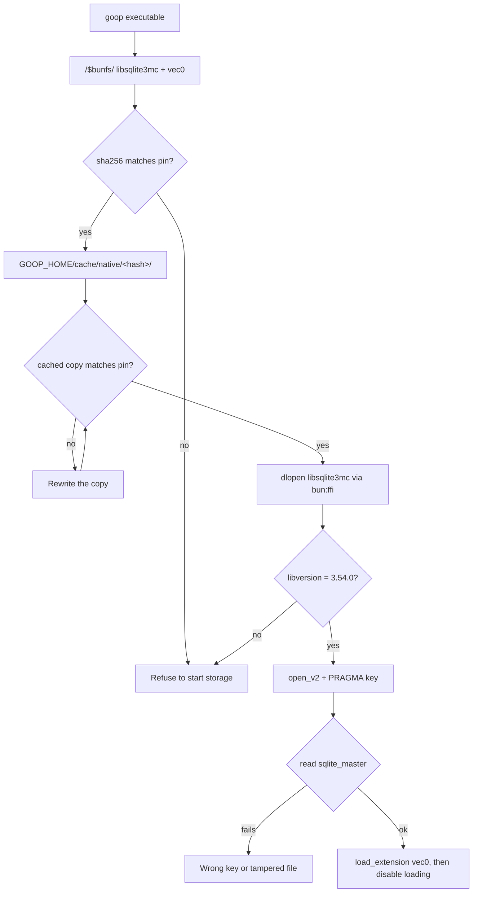

# Spike: encrypted SQLite with FTS5 and sqlite-vec in Bun (T10)

Date: 2026-11-01. Task T10 in [`odd/tasks/goop.md`](../../odd/tasks/goop.md), specs S12, S17 and S24. Linux x86_64 was run; Windows was not run.

## Question

Can goop keep one encrypted SQLite database (SQLite3MultipleCiphers) with FTS5 and sqlite-vec, opened from Bun, inside the single `bun build --compile` executable, on Linux and Windows?

## Short answer

Yes, but not through `bun:sqlite`. On Linux, sqlite3mc built as a shared library and driven through `bun:ffi` passed every check, both from source and from the compiled executable. FTS5 and vec0 worked on the encrypted database, a wrong key could not read it, the file showed no plaintext, the cipher was ChaCha20, and `bun:sqlite` ran side by side without a clash.

One trap was found: `vec0.so` must never be loaded into both SQLite copies in the same process. Doing so crashed Bun with `SIGSEGV`.

## Findings

1. **`bun:sqlite` cannot be the encrypted store on Linux or Windows.** Bun links its SQLite statically, and `Database.setCustomSQLite()` works only on macOS ([Bun SQLite docs](https://bun.com/docs/runtime/sqlite)). The Bun 1.4.2 binary exports no `sqlite3_*` symbols (`nm -D --defined-only` found 0), so nothing can be swapped in.
2. **sqlite3mc replaces SQLite; it is not an extension** ([issue #64](https://github.com/utelle/SQLite3MultipleCiphers/issues/64)). So it must be a second SQLite copy in the process, loaded with `bun:ffi` ([Bun FFI docs](https://bun.com/docs/runtime/ffi)).
3. **The dispatch table hides that second copy.** With `SQLITE3MC_USE_DISPATCH_TABLE`, every SQLite function becomes `static`. The library then exports only three pointers to function tables: `sqlite3mc_api_ext` (the `sqlite3_api_routines` layout from `sqlite3ext.h`), `sqlite3mc_api_core` and `sqlite3mc_api_mc` (comment and code in `sqlite3mc_amalgamation.c` 2.6.1). The built `.so` exports 15 dynamic symbols and none of them is `sqlite3_*`.
4. **bun:ffi can read those tables.** `dlopen` a data symbol without calling it, take its `.ptr`, `read.ptr()` the table, then wrap each slot with `CFunction`. The slot numbers come from the C compiler (`offsetof(sqlite3_api_routines, f) / sizeof(void*)`), for example `open_v2` = 135 and `load_extension` = 196. `enable_load_extension` is not in `sqlite3_api_routines`; it is slot 3 of `sqlite3mc_core_routines`. The wrapper checks `libversion()` = `3.54.0` at load time, as a guard against a wrong slot.
5. **The amalgamation keeps temp data in memory.** It defaults to `SQLITE_TEMP_STORE=2` because temporary files are not encrypted (header comment of `sqlite3mc_amalgamation.c`).
6. **A wrong key still returns ok from `PRAGMA key`.** The first real read fails with `file is not a database (rc 26)`. The key has to be verified with a read of `sqlite_master`, as the research predicted.
7. **sqlite-vec loads through the API pointer, not through symbols.** `vec0.so` has no undefined `sqlite3_*` symbols, so it binds to whichever SQLite calls `sqlite3_vec_init`. It keeps that pointer in one global, so a second load into another SQLite copy redirects the first copy's calls (item g below).
8. **`bun build --compile` embeds `.so` files with `with { type: "file" }`.** They appear as `/$bunfs/root/libsqlite3mc-a8hdbp6m.so` and `/$bunfs/root/vec0-6zn72t7p.so` ([Bun executables docs](https://bun.com/docs/bundler/executables)). `dlopen` cannot read `/$bunfs/`. Copying them to a cache folder, checking their sha256 and loading the copy works.
9. **sqlite3mc 2.6.1 ships Cosign-signed `SHA256SUMS`** ([release v2.6.1](https://github.com/utelle/SQLite3MultipleCiphers/releases/tag/v2.6.1)). **sqlite-vec v0.1.9 publishes `checksums.txt`** ([release v0.1.9](https://github.com/asg017/sqlite-vec/releases/tag/v0.1.9)). The GitHub API `digest` field of each asset matched both files.
10. **The official Windows DLL looks usable** (static inspection only). `sqlite3mc_x64.dll` exports the plain `sqlite3_*` names, including `sqlite3_open_v2`, `sqlite3_key`, `sqlite3_load_extension` and `sqlite3_enable_load_extension`. It imports only `KERNEL32.dll`, and its compile-option strings include `ENABLE_FTS5`, `THREADSAFE=1` and `TEMP_STORE=2`.

## Artifacts

| Artifact                                                   | sha256                                                             | Verification                                                       |
| ---------------------------------------------------------- | ------------------------------------------------------------------ | ------------------------------------------------------------------ |
| `sqlite3mc-2.6.1-sqlite-3.54.0-amalgamation.zip`           | `3f25af603566a23c821d8e581778b5ece2a541d2435776de57b8d845c176815a` | Matches `sqlite3mc-2.6.1-SHA256SUMS`; Cosign signature NOT checked |
| `sqlite3mc-2.6.1-SHA256SUMS`                               | `45724e1719a4ad924ddb5b65ac76cde9d6fb2d3f1f1bf91956b4088d2712e6b5` | Matches the GitHub asset digest only; `.sig` / `.pem` not checked  |
| `sqlite-vec-0.1.9-loadable-linux-x86_64.tar.gz`            | `b959baa1d8dc88861b1edb337b8587178cdcb12d60b4998f9d10b6a82052d5d7` | Matches `checksums.txt` (no signature published)                   |
| `vec0.so` (inside the archive above)                       | `5923730861b86c707cca5602b5f91092f9e52a46706dbc6e269fd4bb9c4498e8` | Pinned in `check.ts`                                               |
| `checksums.txt` (sqlite-vec)                               | `d769550da143ea7995aaaa9253b912ae1c96670460a5f798a569a9ee1af6b423` | Matches the GitHub asset digest only                               |
| `libsqlite3mc.so` (local build, gcc 16.2.1, glibc 2.44)    | `5ed60d03de21885795e111d82b71f0f667ac8e00059eec10cce305d05caf6aad` | Built here; not reproducible across compilers                      |
| `sqlite3mc-2.6.1-sqlite-3.54.0-win64.zip` (inspected only) | `0183b85d2abc9e3418abd92736cb71355b2bc933f6cda6b56f91653e6628cd74` | Matches `SHA256SUMS`                                               |
| `sqlite3mc_x64.dll` (inside the archive above)             | `683927db7e16cca301c5f2a236830de28c26b47f01d948f6abf2f0d60776ce4d` | Not run                                                            |
| `sqlite-vec-0.1.9-loadable-windows-x86_64.tar.gz` (listed) | `51581189d52066b4dfc6631f6d7a3eab7dedc2260656ab09ca97ab3fb8165983` | Matches `checksums.txt`; contains only `vec0.dll`; not run         |

## Spike code

All of it lives in [`scripts/spikes/encrypted-sqlite/`](../../scripts/spikes/encrypted-sqlite/). It is spike code, not product code.

| File                 | Role                                                                                                                                      |
| -------------------- | ----------------------------------------------------------------------------------------------------------------------------------------- |
| `build-artifacts.ts` | Downloads the pinned archives, checks sha256, rejects unsafe archive paths, extracts each into a fresh folder, compiles `libsqlite3mc.so` |
| `sqlite3mc.ts`       | The `bun:ffi` wrapper: dispatch-table mode (Linux build) and plain-exports mode (Windows DLL, untested)                                   |
| `native-cache.ts`    | Copies an embedded library to `<cache>/<hash prefix>/<name>`, checks sha256 before and after the copy                                     |
| `check.ts`           | Runs checks a-f, prints PASS/FAIL, exits 1 on any FAIL; runs probe g in a child process                                                   |
| `native-files.d.ts`  | Module types for `.so` and `.sha256` file imports                                                                                         |

## Commands

Run from the repository root. `scripts/run.ts` sets `GOOP_HOME=.local/` and `TMPDIR=.temp/tmp/`.

```sh
# Download, verify, extract and build into .local/build/sqlite/
bun scripts/run.ts bun scripts/spikes/encrypted-sqlite/build-artifacts.ts

# The compile step inside build-artifacts.ts
gcc -O2 -fPIC -shared -DSQLITE_ENABLE_FTS5 -DSQLITE3MC_USE_DISPATCH_TABLE -DSQLITE_THREADSAFE=1 \
  -o .local/build/sqlite/libsqlite3mc.so .temp/extract/sqlite3mc-2.6.1-<random>/sqlite3mc_amalgamation.c -lm -lpthread

# Checks from source
bun scripts/run.ts bun scripts/spikes/encrypted-sqlite/check.ts

# Compiled executable, run against an empty cache so the copy out of /$bunfs/ is exercised
bun scripts/run.ts bun build --compile scripts/spikes/encrypted-sqlite/check.ts \
  --outfile .local/build/sqlite/goop-spike-check
GOOP_SPIKE_CACHE=$PWD/.temp/scratch/compiled-cache bun scripts/run.ts .local/build/sqlite/goop-spike-check
```

The build took about 32 s, all of it compiling the amalgamation. The compiled executable is 83 MB, almost all of it the Bun runtime.

## Results

Linux x86_64, Bun 1.4.2. Source and compiled runs gave the same output, and both exited 0.

| Item | Check                                                                  | Source | Compiled | Observed                                                                                     |
| ---- | ---------------------------------------------------------------------- | ------ | -------- | -------------------------------------------------------------------------------------------- |
| a    | Keyed DB, FTS5 table and vec0 table, MATCH and KNN                     | PASS   | PASS     | FTS5 `"langgraph"` -> `[1]`; `k = 2` -> `[[1,0],[4,0.1414…]]`; `v0.1.9`                      |
| b    | Reopen with the right key: rows readable                               | PASS   | PASS     | Plain rows, FTS5 and vec0 read back                                                          |
| c    | Reopen with a wrong key: `sqlite_master` unreadable                    | PASS   | PASS     | `PRAGMA key` ok, then `file is not a database (rc 26)`                                       |
| d    | Raw file has no plaintext marker                                       | PASS   | PASS     | 81920 bytes, no marker, no `SQLite format 3` header; the unkeyed control DB shows the marker |
| e    | Cipher is ChaCha20                                                     | PASS   | PASS     | `PRAGMA cipher` -> `chacha20`; `sqlite3mc_config('cipher')` -> `chacha20`                    |
| f    | `bun:sqlite` in-memory DB in the same process while sqlite3mc is open  | PASS   | PASS     | `bun:sqlite` 3.53.2 (FTS5 ok) next to sqlite3mc 3.54.0                                       |
| g    | INFO: `vec0.so` loaded into `bun:sqlite` and sqlite3mc in one process  | crash  | crash    | `SIGSEGV` on the first sqlite3mc vec0 query after `bun:sqlite` loaded vec0                   |
| -    | Compiled: embedded libraries copied to the cache, hash checked, loaded | -      | PASS     | Cache files have the pinned hashes                                                           |
| -    | Compiled: a tampered cached `vec0.so` is replaced, not loaded          | -      | PASS     | The cached file was rewritten with the pinned hash; a-f passed                               |

Probe g runs in a child process and does not change the exit code. Its last output before the crash was `step: bun:sqlite vec_version v0.1.9`.

## Runtime loading flow



## What changes for S12

S12 lists "bun:sqlite + SQLite3MultipleCiphers + sqlite-vec + FTS5" as one stack. The spike shows that they cannot all live in `bun:sqlite`. The proposed design, for an ADR before T16:
- **The encrypted database goes through sqlite3mc via `bun:ffi`**, in a storage adapter that owns the FFI wrapper. FTS5 and sqlite-vec run there.
- **`bun:sqlite` stays only for unencrypted, non-personal stores**, if any (for example a cache or a test double). Otherwise it is dropped.
- **sqlite-vec is loaded into the sqlite3mc copy only.** `bun:sqlite` must never load it in the same process, or the process can crash (item g). A test should keep it that way.
- **The key is not passed as SQL text in production.** The spike used `PRAGMA key = '...'`. T16 should call `sqlite3_key` through the `sqlite3mc_api_mc` table, or use `PRAGMA hexkey` with the data key from T11, then verify the key with a `sqlite_master` read.
- **Native libraries ship inside the executable**, are copied to `GOOP_HOME/cache/native/<hash>/` and are checked against sha256 values pinned at CI build time, before every load.

The S# text is unchanged. This note and the ADR record the design.

## Risks

- **Two SQLite copies in one process.** The dispatch table removes symbol clashes, and item f passed. The sqlite3mc source still warns that the two copies must never open the same database file, because their locks do not see each other. The design must keep every file owned by exactly one copy.
- **vec0 global state.** A second load of `vec0.so` into another SQLite copy redirects its API pointer and crashes (item g). This applies on every OS.
- **No Cosign verification.** `cosign` is not installed, so the `SHA256SUMS` signature (`.sig` and `.pem`) was not checked. The hashes only prove that the files match what the GitHub release serves. CI should verify the signature before pinning.
- **sqlite-vec is pre-v1** (v0.1.9). Its storage format and API may change. Its license was not verified here and must be checked before it enters `THIRD_PARTY_LICENSES.md`.
- **Maintaining an FFI wrapper.** The slot numbers depend on the `sqlite3ext.h` layout. They only ever grow at the end, but a CI step should regenerate them from the headers on every sqlite3mc bump. The `libversion` guard catches only some mistakes. Wrong FFI types crash the process instead of throwing.
- **Leaked crypto symbols.** The dispatch-table build still exports 12 non-SQLite symbols (`crypto_stream_chacha20_*`, `crypto_onetimeauth_poly1305_*`, `sqlite3mcChaCha20Hw*`). They could clash with another library that uses the same names. A linker version script exporting only `sqlite3mc_api_*` would close this.
- **Check-then-load gap.** The cache copy is hashed and then `dlopen`ed. A process running as the same user could swap it in between. The cache folder is `0700`, which is enough in this threat model, but it is not atomic.
- **Local build.** The spike's `libsqlite3mc.so` hash is machine-specific. CI must build it in a pinned image and embed that hash.

## Windows plan for CI (not run)

1. In the Windows CI job, download `sqlite3mc-2.6.1-sqlite-3.54.0-win64.zip` and `sqlite-vec-0.1.9-loadable-windows-x86_64.tar.gz`, then check the sha256 values above.
2. Verify the `SHA256SUMS` Cosign signature with a pinned `cosign` in CI.
3. Use the official `dll/sqlite3mc_x64.dll`. Windows resolves imports per module, so the plain `sqlite3_*` exports do not interpose on Bun's SQLite. The wrapper's `exports` mode loads it by name.
4. Run `PRAGMA compile_options` on the DLL and assert that `ENABLE_FTS5` is present. The strings were seen statically; the runtime check is still to do.
5. Embed `sqlite3mc_x64.dll` and `vec0.dll`, copy them to `%LOCALAPPDATA%\goop\cache\native\<hash>\` (`GOOP_HOME` in CI), and run the compiled `check.ts` with the same items a-f. The `.so` file types in the imports become `.dll`.
6. Expect probe g to crash on Windows too, since it comes from vec0's global API pointer.
