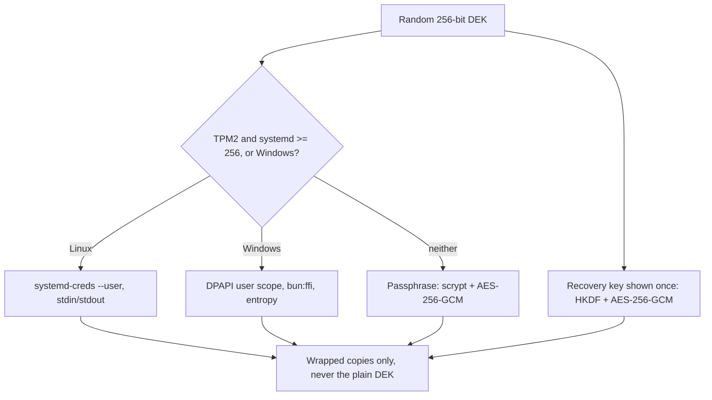

# Spike: wrapping the data key with TPM2 and DPAPI (T11)

Date: 2026-11-01. Task T11 in [`odd/tasks/goop.md`](../../odd/tasks/goop.md), specs S24 and S25. Linux x86_64 ran on the user's PC with the user's permission; Windows 11 x64 ran in a throwaway VM through `bun run windows:run` ([`docs/development/windows-vm.md`](../development/windows-vm.md)).

## Question

Can goop keep its random data key (DEK) wrapped by the operating system, so that only the same user on the same machine can open it, from inside the single `bun build --compile` executable, on Linux and Windows? And can a recovery key and a passphrase wrap the same DEK when the OS cannot?

## Short answer

Yes. On Linux, `systemd-creds --user` wrapped and unwrapped the DEK with the host key and the TPM2, scoped to the calling user, from source and from the compiled executable. On Windows 11, DPAPI in user scope, called through `bun:ffi`, did the same in an executable cross-compiled on Linux, and a second local user could not open the blob. The recovery key and the scrypt passphrase passed on both systems.

Two costs were found. On Linux, the first use creates a system file, `/var/lib/systemd/credential.secret`. On Windows, DPAPI failed for the owner for about 20-40 s after another user logged on; the owner's checks passed only after waiting.

## Findings

1. **`--with-key=tpm2` is refused in user scope.** Without any system change, `systemd-creds --user encrypt --with-key=tpm2` printed `Selected key not available in --uid= scoped mode, refusing.` In systemd v262, `src/creds/creds.c:994-1010` allows only the host key or host+tpm2 in user scope.
2. **host+tpm2 needs the host key, and systemd creates it.** `/var/lib/systemd/credential.secret` did not exist. With the user's permission, systemd created it on first use: root, `0400`, 4112 bytes, written by the root `io.systemd.Credentials` service. A listing before and after showed no other change; `/run/systemd/tpm2-srk-public-key.pem` did not appear.
3. **goop needs no root and no `tss` group.** User `ztc` is not in group `tss`, and `/dev/tpmrm0` is `root:tss 0660`. The varlink service does the TPM work.
4. **The credential is bound to the user, the name and the SRK.** Its key type id is `2a1f877a4275431ab3f9ed1f5d8f6601`, `CRED_AES256_GCM_BY_HOST_AND_TPM2_HMAC_SCOPED_PINNED_SRK` in systemd v262 `src/shared/creds-util.h`. A wrong `--name` fails with `Name in credential doesn't match expectations.` Decrypting it with `--uid=0` or in system scope fails with `io.systemd.InteractiveAuthenticationRequired` (tried by hand).
5. **The key never touches argv or a file.** goop runs `systemd-creds --user encrypt|decrypt --name=goop-dek - -` and passes the DEK and the credential through stdin and stdout.
6. **The format is new.** `man systemd-creds`: from v262, credentials are pinned to the TPM2 SRK and are incompatible with earlier systemd versions. `--user` exists since v256.
7. **DPAPI works through `bun:ffi`.** `crypt32.dll` `CryptProtectData` and `CryptUnprotectData` in user scope, with `CRYPTPROTECT_UI_FORBIDDEN` and the entropy `goop-dek-v1`. The output buffer is copied, zeroed and released with `LocalFree`.
8. **A second Windows user needs the batch logon right to run as a task.** Without `SeBatchLogonRight`, the scheduled task never ran (`LastTaskResult` 267011 = `0x41303`). `Start-Process -Credential` over SSH failed with `0xC0000142`. After granting the right with `secedit`, the task ran as `goopother`, whose random password was generated inside the VM and never printed.
9. **DPAPI breaks for a while after another user logs on.** Right after `goopother` logged on through the task, the owner's `CryptProtectData` failed with `GetLastError 0x00000005`, and unwrapping an existing blob failed with `0x8009000b`. Both recovered by themselves after about 20-40 s.
10. **DPAPI worked over SSH.** The SSH session is a network logon (type 3). It probably worked because the VM also logs `goop` onto the console automatically; this was not proven.

## Environment

| Item              | Linux                                | Windows                                                            |
| ----------------- | ------------------------------------ | ------------------------------------------------------------------ |
| System            | Arch Linux x86_64, the user's PC     | Windows 11 Enterprise LTSC evaluation, throwaway VM                |
| Key store         | systemd 262, TPM2 (`has-tpm2` = yes) | DPAPI, user scope                                                  |
| Bun               | 1.4.2                                | 1.4.2, cross-compiled on Linux                                     |
| Executable        | source and `bun build --compile`     | `goop-key-check.exe`                                               |
| Executable sha256 | -                                    | `20af20c604e20da9958735383661c9ca5019a63888ef33502022159845b25b3b` |
| Spike commit      | `c3d2808`                            | `219fbbd`                                                          |

## Spike code

All of it lives in [`scripts/spikes/key-wrapping/`](../../scripts/spikes/key-wrapping/). It is spike code, not product code.

| File                 | Role                                                                                                  |
| -------------------- | ----------------------------------------------------------------------------------------------------- |
| `systemd-creds.ts`   | Wraps and unwraps through `systemd-creds --user`, the key only on stdin and stdout                    |
| `dpapi.ts`           | DPAPI through `bun:ffi` on `crypt32.dll` and `kernel32.dll`                                           |
| `envelope.ts`        | Recovery key (HKDF-SHA256) and passphrase (scrypt) envelopes with AES-256-GCM from WebCrypto          |
| `envelope-checks.ts` | Items r and p, shared by both platforms                                                               |
| `report.ts`          | Collects PASS/FAIL per item, prints them, exits 1 on any FAIL                                         |
| `check.ts`           | Linux entry: items a, b, r, p                                                                         |
| `check-windows.ts`   | Windows entry: items a, b, u, r, p, plus the `--wrap` and `--unwrap` helpers for item u               |
| `run-windows.ps1`    | VM script: creates `goopother`, grants the batch logon right, runs item u, retries the owner, reports |

## Commands

Run from the repository root. `scripts/dev-env/run.ts` sets `GOOP_HOME=.local/` and `TMPDIR=.temp/tmp/`. On Linux, the first run creates `/var/lib/systemd/credential.secret` if it does not exist (finding 2).

```sh
# Linux, from source
bun scripts/dev-env/run.ts bun scripts/spikes/key-wrapping/check.ts

# Linux, compiled
bun scripts/dev-env/run.ts bun build --compile scripts/spikes/key-wrapping/check.ts \
  --outfile .local/build/key-wrapping/goop-key-check

# Windows: cross-compile, then run in a throwaway Windows 11 VM
bun scripts/dev-env/run.ts bun build --compile --target=bun-windows-x64 \
  scripts/spikes/key-wrapping/check-windows.ts --outfile .local/build/key-wrapping/goop-key-check.exe
bun run windows:run -- --copy .local/build/key-wrapping/goop-key-check.exe \
  --copy scripts/spikes/key-wrapping/run-windows.ps1 --fetch 'C:\goop\result.txt' --fetch 'C:\goop\steps.txt' -- \
  'powershell -NoProfile -ExecutionPolicy Bypass -File C:\goop\run-windows.ps1; exit $LASTEXITCODE'
```

## Results

Linux source and compiled runs gave the same results. Windows ran only the compiled executable. Every item that ran passed.

| Item | Check                                       | Linux source | Linux compiled | Windows compiled | Observed                                                                                                                                                                                                             |
| ---- | ------------------------------------------- | ------------ | -------------- | ---------------- | -------------------------------------------------------------------------------------------------------------------------------------------------------------------------------------------------------------------- |
| a    | OS round trip; the key is not in the output | PASS         | PASS           | PASS (waited)    | Linux: 768-byte credential (base64 text), host+tpm2 scoped, pinned SRK; wrap ~290 ms, unwrap ~610-630 ms. Windows: 262-byte blob; wrap 2.0 ms, unwrap 0.3 ms                                                         |
| b    | Tamper and a wrong binding are rejected     | PASS         | PASS           | PASS (waited)    | Linux: flipped byte -> `Failed to decrypt: io.systemd.System`; wrong name -> `Name in credential doesn't match expectations.` Windows: tampered, wrong entropy and no entropy -> `0x0000000d` (`ERROR_INVALID_DATA`) |
| u    | Another user cannot unwrap                  | not run      | not run        | PASS             | `goopother`: `CryptUnprotectData failed: GetLastError 0x8009000b` (`NTE_BAD_KEY_STATE`); owner `goop` opened the same blob                                                                                           |
| r    | Recovery key round trip                     | PASS         | PASS           | PASS             | Typed form (lowercase, spaces, `o` for `0`) accepted; wrong key and tamper rejected                                                                                                                                  |
| p    | Passphrase fallback                         | PASS         | PASS           | PASS             | scrypt `N=2^17 r=8 p=1`: ~335-360 ms per derivation on Linux, 271 ms on Windows; wrong passphrase and tamper rejected                                                                                                |

**Windows a and b passed only after waiting.** `run-windows.ps1` runs item u first, then retries the owner's wrap every 5 s, up to 180 s, before the report. The owner's wrap failed with `0x00000005` until DPAPI recovered (finding 9). A run of the report right after the other user's logon would have failed a and b.

On Linux, item u is covered by hand only: the `--uid=0` and system-scope decrypts in finding 4. No second Linux user was created.

The recovery key is 160 random bits, written as 32 Crockford base32 characters in 8 groups of 4. HKDF-SHA256 turns it into an AES-256-GCM key; the additional data is `goop-dek-v1`. The passphrase uses scrypt with `maxmem` 256 MiB, then AES-256-GCM.

## Key wrapping design

The design below is recorded in [ADR 0002](../adr/0002-data-key-wrapping.md).



## What changes for S24

S24 lists "envelope keys (TPM2 / DPAPI / recovery key)". The spike keeps that and adds two details:

- **On Linux, "TPM2" means host+tpm2 through `systemd-creds --user`.** tpm2 alone is refused in user scope (finding 1).
- **A passphrase wraps the DEK when the OS cannot.** It covers a machine without a TPM2 or without systemd 256.

The S# text is unchanged. This note and the ADR record the design.

## Limits

- **System change on Linux.** `/var/lib/systemd/credential.secret` was created by this spike. T11 asks to undo system changes afterwards; that step is still pending with the user. Deleting the host key makes every credential wrapped with it unreadable.
- **The DPAPI outage was seen once, in a VM.** Its cause was not found. It was not tried on a real Windows PC.
- **Logon types.** Only the SSH network logon (with `goop` also on the console) and a batch logon of another user were run. An interactive-only logon, and the owner's daemon under a scheduled task, were not tested.
- **`GetLastError` is read in a separate FFI call.** Bun could in theory overwrite the code between the two calls. The observed codes were consistent.
- **One systemd version.** Only v262 was run. Older versions cannot read v262 credentials (finding 6), and a TPM clear or an OS reinstall was not tried.
- **Timings are single runs.** They come from the spike output, not from a benchmark.
