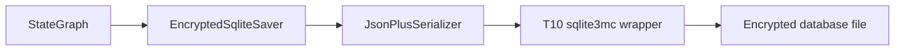
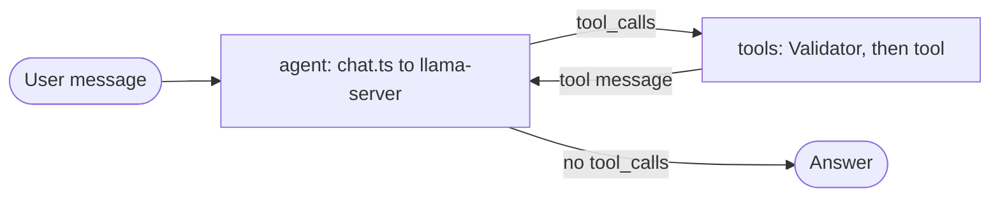

# Spike: LangGraph on Bun with an encrypted checkpointer and tool calling (T14)

Date: 2026-11-02. Task T14 in [`odd/tasks/goop.md`](../../odd/tasks/goop.md), specs S20 and S24. The spike code was in `scripts/spikes/langgraph/`: `checkpoint/` for the saver and `tools/` for tool calling. This note is the spike's proposal; the product code is written in T16, T18, T21 and T24.

## Question

Does LangGraph run on Bun with its checkpoints in the encrypted sqlite3mc store (ADR 0001), including `interrupt()` and resume across processes? And do gpt-oss-20b and Qwen 3.5 9B call tools reliably through llama-server, with a code Validator in front of the tools (S20)?

## Short answer

Yes to both. A custom `EncryptedSqliteSaver` over the T10 sqlite3mc wrapper passes every check, from source and from a `bun build --compile` executable: a graph runs to completion, `interrupt()` pauses and a second process resumes, AsyncLocalStorage did not break, and the database file has no plaintext. Both models passed 4 tool-calling scenarios 5 out of 5 times at temperature 0, with no server errors in 60 runs. Qwen answers a single search in about 5 s, gpt-oss in about 15 s.

One finding changes how S20 reads: the models never broke a limit stated in the JSON schema, so the Validator matters for checks that only code can see, not for schema limits.

## Findings

1. **Schema limits prevent most bad arguments.** Asked for 25 results with `limit` capped at 10, both models sent 10. The Validator never fired until the offer id check moved into a zod `.refine()`, which the JSON schema does not show. Then "Open offer 102" gave `{"id":"102"}`, the Validator returned the error, and the model retried with `{"id":"off-102"}`: 5 out of 5 on both models.
2. **A recursion limit is a needed guard.** A first run stopped with LangGraph's "Recursion limit of 12 reached": gpt-oss kept calling `search_offers` trying to get 25 results.
3. **Both models return standard OpenAI `tool_calls`.** gpt-oss tool-call turns had empty content. Qwen with thinking off returned no reasoning.
4. **gpt-oss does extra work.** On the single search it searches, then opens 2 offers: 15 calls in 5 runs against 5 for Qwen, hence about 15 s against 5 s.
5. **llama.cpp#19701 is not present on v0.8.0.** An assistant turn with content, reasoning and tool calls got HTTP 200, and so did the variant with blank content. The blank-content retry in `chat.ts` stays as a safety net.
6. **AsyncLocalStorage held.** Bun has an open issue on it (oven-sh/bun#21303), and `interrupt()` and `getConfig()` depend on it. Both worked after 4 nested awaits, `setTimeout` and `Promise.all`, in both processes. Raw AsyncLocalStorage kept its store across `setTimeout`, `Promise.all`, `queueMicrotask` and `Bun.sleep`. Streams, EventEmitter and workers were not tested.

## Environment

| Item          | Value                                                     |
| ------------- | --------------------------------------------------------- |
| CPU           | AMD Ryzen 9 7940HS                                        |
| GPU used      | AMD Radeon RX 7700S, `Vulkan1`                            |
| System        | Linux                                                     |
| Bun           | 1.4.2                                                     |
| llama-server  | `v0.8.0`, T12 build from run `41379281254`                |
| sqlite3mc     | `libsqlite3mc.so` rebuilt with T10's `build-artifacts.ts` |
| Spike commits | `3f7fb53`, `1a5a0c0`, `37bc427`, `70c14f9`, `ceb48ae`     |

The rebuilt `libsqlite3mc.so` has sha256 `5ed60d03de21885795e111d82b71f0f667ac8e00059eec10cce305d05caf6aad`.

## Packages

All are devDependencies for the spike. The user chose LangGraph with our own `fetch` client, without a LangChain model package (L57).

| Package                           | Version | Why                                                                                           |
| --------------------------------- | ------- | --------------------------------------------------------------------------------------------- |
| `@langchain/langgraph`            | 1.6.0   | `StateGraph`, `interrupt()`, `Command`, `MemorySaver`                                         |
| `@langchain/core`                 | 1.3.2   | Messages and `RunnableConfig`                                                                 |
| `@langchain/langgraph-checkpoint` | 1.2.2   | Declared because the saver imports `WRITES_IDX_MAP`, `writesSortKey`, `compareWritesSortKeys` |
| `zod`                             | 4.6.7   | Tool schemas, exported with `z.toJSONSchema`                                                  |

The install adds 22 packages. The 11 checked by hand (the LangChain packages, `langsmith`, `js-tiktoken`, `p-queue`, `zod`, `mustache`, `@cfworker/json-schema`) are MIT and have no install scripts; no package in the tree ships a native `.node` addon.

## Encrypted checkpointer

### Design

LangGraph checkpoints hold the whole conversation, so ADR 0001 keeps them out of `bun:sqlite`. `@langchain/langgraph-checkpoint-sqlite` uses better-sqlite3, which is native and unencrypted. The spike writes its own saver instead.

- **`EncryptedSqliteSaver` extends `BaseCheckpointSaver`** over the T10 sqlite3mc wrapper. It implements `getTuple`, `list`, `put`, `putWrites` and `deleteThread`.
- **`list`** scans the thread in SQL, then applies `limit`, `before` and `filter` in JS.
- **`putWrites`** uses `WRITES_IDX_MAP[channel] ?? index`. Negative special indexes use `INSERT OR REPLACE`; regular ones use `INSERT OR IGNORE`, as `MemorySaver` does. Pending writes are sorted with `writesSortKey` and `compareWritesSortKeys`.
- **Blobs** go through the saver's serde (`JsonPlusSerializer`). Metadata is decoded with the checkpoint's serde type; both are `json`.
- **Not done:** no migration of pre-v4 checkpoints and no `getDeltaChannelHistory` override.



### Results

6 contract tests run on a temporary encrypted database; they are skipped in CI, where `libsqlite3mc.so` is missing. `checkpoint/check.ts` passed every item from source and from a `bun build --compile` executable with an empty native cache:

| Item | Check                | Result                                                                                                                                         |
| ---- | -------------------- | ---------------------------------------------------------------------------------------------------------------------------------------------- |
| a    | Run to completion    | 3 messages, 2 turns, 4 checkpoints stored (input `-1`, then loop `0`-`2`); `getState` restores them                                            |
| b    | Interrupt and resume | `interrupt()` pauses at node `ask`; a second process resumes with `new Command({ resume })` on the same `thread_id`: 4 messages, last "Saved." |
| c    | AsyncLocalStorage    | `getConfig()` and `interrupt()` work after nested awaits and timers in both processes (finding 6)                                              |
| d    | Encryption at rest   | The 32768-byte file has no plaintext marker and no "SQLite format 3" header; a wrong key fails with "file is not a database (rc 26)"           |

Item b also shows that `HumanMessage` and `AIMessage` survive `JsonPlusSerializer` across processes.

## Tool calling

### Design

- **`chat.ts`** is a `fetch` client for `/v1/chat/completions`. Qwen gets `chat_template_kwargs: { enable_thinking: false }`. gpt-oss keeps the `reasoning_content` of each assistant turn and sends it back on the next turn. It detects llama.cpp#19701 ("Cannot pass both content and thinking") and retries with blank content.
- **`agent.ts`** is a `StateGraph` with `agent -> tools -> agent` and a conditional route, on `MemorySaver`. Three fake tools, `search_offers`, `get_offer` and `save_preference`, have zod schemas exported with `z.toJSONSchema`.
- **The Validator** returns the compact zod error to the model as the tool message.
- **Tool results are untrusted.** They are wrapped as `<tool_result name=… trust="untrusted">`, with the closing tag escaped inside the result.
- **14 unit tests.** One runs the whole graph with a fake model through a validation error and the retry.



`tools/check.ts` runs the real servers one at a time, with T13's hardened flags, clean environment and API key file, and passes `--jinja` explicitly (it is on by default at v0.8.0):

- **Qwen 3.5 9B:** `--device Vulkan1 -ngl 99 -c 8192 -fa on -ctk q8_0 -ctv q8_0`, without MTP on purpose.
- **gpt-oss-20b:** `--device Vulkan1 -c 8192 -fa on --fit on`.

### Results

4 scenarios, 5 runs each per model, temperature 0. ok = runs that passed, calls = tool calls over the 5 runs, invalid = calls the Validator rejected. gpt-oss was run twice; the second run's median is in brackets.

| Model   | Scenario     | ok  | calls | invalid | median ms     |
| ------- | ------------ | --- | ----- | ------- | ------------- |
| Qwen    | `single`     | 5/5 | 5     | 0       | 5150          |
| Qwen    | `two_rounds` | 5/5 | 10    | 0       | 4577          |
| Qwen    | `recovery`   | 5/5 | 10    | 5       | 3395          |
| Qwen    | `no_tool`    | 5/5 | 0     | 0       | 429           |
| gpt-oss | `single`     | 5/5 | 15    | 0       | 14917 (16393) |
| gpt-oss | `two_rounds` | 5/5 | 10    | 0       | 6484 (6555)   |
| gpt-oss | `recovery`   | 5/5 | 10    | 5       | 7081 (7260)   |
| gpt-oss | `no_tool`    | 5/5 | 0     | 0       | 3070 (3072)   |

No server errors in 60 runs.

The `two_rounds` row is weaker than it looks: a run passed when `get_offer` was called with any of the three valid ids, while the prompt asked for the first result, and the final answer was never checked for the company name. Its 5/5 may be inflated (native review, finding R3-two-rounds).

## How to run

The spike code was removed from the repository after the spike and can be read in git history at commit `03507e4`, path `scripts/spikes/langgraph/`, for example `git show 03507e4:scripts/spikes/langgraph/checkpoint/saver.ts`. The commands below ran against it.

Both checks expect the T10 `libsqlite3mc.so` under `.local/build/sqlite/`; the tool check also expects the T12 Linux build and the T13 models under `.local/`.

```sh
# Unit and contract tests
bun run test scripts/spikes/langgraph

# Checkpointer, from source
bun scripts/dev-env/run.ts bun scripts/spikes/langgraph/checkpoint/check.ts

# Checkpointer, compiled, with an empty native cache
bun scripts/dev-env/run.ts bun build --compile scripts/spikes/langgraph/checkpoint/check.ts \
  --outfile .temp/scratch/t14-checkpoint/check
GOOP_SPIKE_CACHE=$PWD/.temp/scratch/t14-checkpoint/cache \
  bun scripts/dev-env/run.ts .temp/scratch/t14-checkpoint/check

# Tool calling on real servers, both models or one
bun scripts/dev-env/run.ts bun scripts/spikes/langgraph/tools/check.ts
bun scripts/dev-env/run.ts bun scripts/spikes/langgraph/tools/check.ts qwen
```

The tool check appends one JSON line per run to `.local/langgraph/tools-<timestamp>.jsonl` and prints a table.

## What changes for S20 and S24

S24 asks for an encrypted database; the checkpointer fits it. S20 says the Validator is "code + Qwen judge; returns the error to the agent". The spike confirms the loop, and narrows where the code layer earns its place: schema limits already guide the models (finding 1), so the code Validator matters for checks the schema cannot express.

The S# text is unchanged. What the next tasks inherit:

- **T16 (storage):** the saver moves to product code on the T16 store. The spike wrapper sets the key with `PRAGMA key` as text; ADR 0001 wants `sqlite3_key` or a hex key.
- **T18 (models):** `--jinja` is passed explicitly; the server path is duplicated from `bench.ts` and belongs in the model manager.
- **T21 (Validator):** keep returning the compact zod error as the tool message; put code-only checks in `.refine()` or after parsing.
- **T24 (Orchestrator):** set a recursion limit (finding 2); keep sending gpt-oss `reasoning_content` back; wrap tool results as untrusted, and make the wrapper hold against case and spacing variants of the tag (the spike escaped only the exact lowercase `</tool_result`, and its test checked only that form; findings R1-001 and R3-delimiter-test); force LangSmith tracing off, because `@langchain/core` ships `langsmith`, which sends traces when `LANGSMITH_TRACING` or `LANGCHAIN_TRACING_V2` is set in the user's environment (raised while reading review finding R1-004 on `package.json`); move the system prompt from `tools/check.ts` to `prompts/` (prompts.md).

## Limits

- **Qwen ran without MTP.** MTP with tool calls was not tested.
- **Fake tools, short conversations.** 3 synthetic offers and 4 scenarios; no long sessions, no compaction, no lazy tools.
- **AsyncLocalStorage, partly.** Streams, EventEmitter and workers were not tested (finding 6).
- **Saver, partly.** No pre-v4 migration, no `getDeltaChannelHistory`; `list` filters in JS after a full scan of the thread.
- **One machine.** Linux only, no Windows run; the contract tests are skipped in CI.
- **`two_rounds` criterion.** It did not check that the first result was opened or that the answer named the company; T24's eval must.
- **Quality was not measured.** The scenarios check tool names and arguments, not answer quality; T28 judges that.
