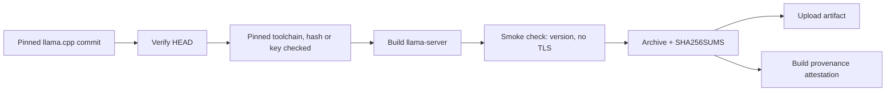

# Spike: CI build of a minimal llama-server (T12)

Date: 2026-11-01. Task T12 in [`odd/tasks/goop.md`](../../odd/tasks/goop.md), specs S23 and S24. The builds ran on GitHub-hosted runners through [`.github/workflows/llama-server.yml`](../../.github/workflows/llama-server.yml). The Linux build also ran on the user's PC; the Windows build ran only on the CI runner.

## Question

Can goop build its own minimal llama-server (CPU and Vulkan, no TLS, no web UI) from a pinned llama.cpp commit, for Linux x64 and Windows x64, in CI, and ship it with a sha256 and a build attestation that a user can verify?

## Short answer

Yes. Run `41378116178` passed both jobs on the first try, in about 10 minutes each. Both archives verify with `gh attestation verify`, and a tampered copy fails. The Linux build listed both GPUs of the user's PC through Vulkan, with no missing shared library.

One security finding changes S24: llama-server always reads config files, and every option also reads a `LLAMA_ARG_*` environment variable. Passing hardened flags on the command line is not enough to control the options goop does not pass (finding 6).

## Findings

1. **The pinned source is checked.** The workflow checks out llama.cpp `v0.8.0`, commit `8642541b255bfb5dc39cd351a178be09013a55d6`, and fails if `HEAD` differs. `llama-server --version` prints `version: 0.8.0-dev (build 1, commit 8642541)`; CMake reports ggml 0.28.0.
2. **The Linux build links no TLS library.** `NEEDED` lists only `libvulkan.so.1`, `libgomp.so.1`, `libstdc++.so.6`, `libgcc_s.so.1`, `libc.so.6` and `ld-linux`. The highest glibc symbol version is `GLIBC_2.34`. The Windows folder ships no ssl or crypto DLL.
3. **`--help` still lists `--ssl-key-file`.** `common/arg.cpp` registers it with no TLS guard at this commit, so the workflow only warns. The hard no-TLS gates are the `NEEDED` check on Linux and the DLL check on Windows.
4. **The Windows build has one network access.** `GGML_OPENMP_FETCH` downloads `LLVM-20.1.8-win64.exe` to get libomp; llama.cpp's CMake pins it with an `EXPECTED_HASH`. The zip ships `libomp.dll` and `LICENSE-LLVM-OpenMP`. `LLAMA_USE_PREBUILT_UI=OFF` keeps the build from downloading the web UI.
5. **Attestation catches tampering.** `gh attestation verify` exited 0 for both archives; a copy with one byte appended failed with exit 1. The plain command prints nothing on success; `--format json` shows the certificate: ref `refs/pull/15/merge`, runner `github-hosted`, signer workflow `llama-server.yml`.
6. **Config files and the environment can turn options on.** `common_params_apply_system_config` (`common/arg.cpp:729-773` at `8642541`) always applies config files before the environment and the command line, with no opt-out. Unknown keys are ignored. Then every option also reads its `LLAMA_ARG_*` variable. Command-line arguments override both, but any option goop does not pass (for example tools, MCP, the slot save path or verbose logging) can be switched on by a config file or a variable.

   | System  | Config files, in order                                                            |
   | ------- | --------------------------------------------------------------------------------- |
   | Linux   | `/etc/llama.cpp/config.ini`, `${XDG_CONFIG_HOME:-~/.config}/llama.cpp/config.ini` |
   | Windows | `%PROGRAMDATA%\llama.cpp\config.ini`, `%APPDATA%\llama.cpp\config.ini`            |

7. **This happened on the user's PC.** The binary printed `using config file: /home/ztc/.config/llama.cpp/config.ini`, a file from 2026-10-22 that was already there; the spike did not read it. With `XDG_CONFIG_HOME` pointed at an empty folder, the user-level file was not used.
8. **The shader generator is a build tool.** The first Windows zip shipped `vulkan-shaders-gen.exe`, which only runs during the build. Commit `560bd21` leaves it out.

## Environment

| Item             | Linux                                            | Windows                                                   |
| ---------------- | ------------------------------------------------ | --------------------------------------------------------- |
| Runner           | `ubuntu-22.04`                                   | `windows-2025`                                            |
| Compiler         | GNU 11.4.0                                       | Clang 20.1.8 (`cmake/x64-windows-llvm.cmake`)             |
| Vulkan SDK       | LunarG 1.4.313 apt repository (newest for jammy) | LunarG 1.4.357.0, installer sha256 checked                |
| Vulkan in CMake  | 1.4.313, with `glslc`                            | -                                                         |
| OpenMP           | `libgomp` from the system                        | `libomp.dll` from LLVM 20.1.8, fetched with a pinned hash |
| Run on a PC      | Arch Linux, Ryzen 9 7940HS, the user's PC        | not run (CI version check only)                           |
| Workflow commits | `42b8871`, `560bd21`                             | `42b8871`, `560bd21`                                      |

## Workflow

The workflow runs on `workflow_dispatch` and when its own file changes (pull request, or a push to `main` or `dev`), never on every pull request (L49). Both jobs pin every action by commit SHA and ask only for `contents: read`, `id-token: write` and `attestations: write`.

| Step           | `linux` job                                                                                       | `windows` job                                                                      |
| -------------- | ------------------------------------------------------------------------------------------------- | ---------------------------------------------------------------------------------- |
| Source         | Check out llama.cpp at the pinned commit, fail if `HEAD` differs                                  | Same                                                                               |
| Toolchain      | Trust the LunarG key only with the pinned fingerprint, install pinned Vulkan and shaderc packages | Download the Vulkan SDK, check its sha256, install it; find `vcvarsall.bat`        |
| Configure      | CMake + Ninja, shared libs, `$ORIGIN` rpath                                                       | CMake + Ninja Multi-Config with clang, `GGML_OPENMP_FETCH=ON`                      |
| Options (both) | Vulkan, CPU variants as loadable backends, OpenMP; no TLS, RPC, web UI, tests, examples or app    | Same                                                                               |
| Build          | Target `llama-server` only                                                                        | Same                                                                               |
| Smoke check    | `--version` names the commit; `--help` TLS warning; `NEEDED` without OpenSSL; highest glibc       | `--version` names the commit; `--help` TLS warning; no TLS DLL in the folder       |
| Package        | Reproducible tarball (sorted, `mtime` 0, owner 0) plus `LICENSE`, `SHA256SUMS`                    | Zip without `vulkan-shaders-gen.exe`, plus `LICENSE`, `SHA256SUMS` with LF endings |
| Publish        | Upload the artifact, attest the archive                                                           | Same                                                                               |



Each archive holds one top folder with `LICENSE`, `llama-server`, `libllama`, `libllama-common`, `libllama-server-impl`, `libmtmd`, `libggml`, `libggml-base`, `libggml-vulkan` and the CPU variants `x64`, `sse42`, `sandybridge`, `ivybridge`, `piledriver`, `haswell`, `skylakex`, `cannonlake`, `cascadelake`, `icelake`, `cooperlake`, `alderlake`, `sapphirerapids` and `zen4`. Windows ships the same files as `.dll`, plus `libomp.dll`.

## How to run and verify

Start the workflow by hand from the Actions tab, or with `gh workflow run llama-server.yml`. GitHub offers a manual run only for workflows on the default branch, so until this file reaches `main` it runs from a pull request that changes it (as PR #15 did; not tried by hand). Then download the artifacts of the run into a new, empty folder under `.temp/` and check them:

```sh
# Check the archive against the checksum file
sha256sum -c SHA256SUMS

# Check the build provenance (prints nothing on success; add --format json to see the certificate)
gh attestation verify llama-server-v0.8.0-linux-x64-vulkan.tar.gz \
  --repo ztc0/goop --signer-workflow ztc0/goop/.github/workflows/llama-server.yml

# Unpack into .local/ and list the GPUs, with an empty config folder (finding 6)
mkdir -p .temp/scratch/empty-config
XDG_CONFIG_HOME="$PWD/.temp/scratch/empty-config" ./llama-server --list-devices
```

## Results

| Check                         | Linux                                                                                                                                                        | Windows                                                                                                                                                                            |
| ----------------------------- | ------------------------------------------------------------------------------------------------------------------------------------------------------------ | ---------------------------------------------------------------------------------------------------------------------------------------------------------------------------------- |
| Run `41378116178`             | PASS, 02:30:43 -> 02:41:04 UTC                                                                                                                               | PASS, 02:30:43 -> 02:40:50 UTC                                                                                                                                                     |
| Run `41379281254` (`560bd21`) | PASS, 02:44:04 -> 02:53:44 UTC; tar.gz byte-identical to run 1 (`e99fe8d9…`); attestation verifies                                                           | PASS, 02:44:04 -> 02:56:12 UTC; zip 25,281,219 bytes, sha256 `fb5349f0739b6573bd0654af96b1609a030a72d4dd16c9bba9961429f2c9e2db`, no `vulkan-shaders-gen.exe`; attestation verifies |
| `--version`                   | `version: 0.8.0-dev (build 1, commit 8642541)`, `built with GNU 11.4.0 for Linux x86_64`                                                                     | `version: 0.8.0-dev (build 1, commit 8642541)`, `built with Clang 20.1.8 for Windows x86_64`                                                                                       |
| No TLS                        | PASS: no `libssl` or `libcrypto` in `NEEDED`                                                                                                                 | PASS: no ssl or crypto DLL                                                                                                                                                         |
| Archive                       | `llama-server-v0.8.0-linux-x64-vulkan.tar.gz`, 26,483,837 bytes, 78 MB unpacked                                                                              | `llama-server-v0.8.0-windows-x64-vulkan.zip`, 25,376,450 bytes (run 1, still with `vulkan-shaders-gen.exe`)                                                                        |
| sha256                        | `e99fe8d96c61b5246953d9a041709f71e24c89d79442e5da2fec0effe26f95e7`                                                                                           | `685c7a88990d09e95a17690e282f63938893fa07ce0e4872b51ff7acd5fbddf9`                                                                                                                 |
| Attestation                   | PASS (exit 0); tampered copy FAIL (exit 1)                                                                                                                   | PASS (exit 0); tampered copy FAIL (exit 1)                                                                                                                                         |
| Run on the user's PC          | PASS: `Vulkan0: AMD Radeon 780M Graphics (RADV PHOENIX) (16205 MiB, 15487 MiB free)`, `Vulkan1: AMD Radeon RX 7700S (RADV NAVI33) (8176 MiB, 8149 MiB free)` | not run                                                                                                                                                                            |

## What changes for S23 and S24

S23 says "download our CI-built minimal llama-server". The spike shows it can be built and verified, and adds two details:

- **The archive is checked twice.** goop checks the sha256 and the build attestation before it unpacks anything.
- **The Windows build fetches libomp.** It is the only network access during the build, and it is pinned by hash in llama.cpp's CMake.

S24 says "hardened llama-server flags and forbidden-flag check". Finding 6 means the flags goop passes are not the whole configuration. T18 has to choose among these options; this spike does not decide:

- **Own the config folders.** Start the child with a goop-owned `XDG_CONFIG_HOME` or `APPDATA` and a cleaned environment without `LLAMA_ARG_*`.
- **Keep the runtime check.** Read `/props` after start and compare it with the expected settings.
- **Patch the config loader out.** Remove `common_params_apply_system_config` in our build, because `/etc` and `%PROGRAMDATA%` cannot be redirected through the environment.

The S# text is unchanged. This note records the finding for T18.

## Limits

- **The verify command accepts pull-request runs.** `--signer-workflow` pins the workflow file, not the ref, and this spike's attestations come from `refs/pull/15/merge`. T18 must also pin the ref that may sign real builds (for example `--source-ref refs/heads/main`). Found by the native review (finding R1, advisory).
- **The Windows build did not run on a PC.** It ran only the `--version` smoke check on the CI runner, not in the goop Windows VM, and no Windows GPU was listed.
- **Windows was only smoke-tested on the CI runner.** The zip from run `41379281254` was not run in the goop Windows VM or on a real Windows PC with a GPU.
- **One run per job.** Timings come from a single run, not from a benchmark.
- **The attestation ref is a pull request merge ref.** The certificate names `refs/pull/15/merge`, not `dev` or `main`.
- **No model was loaded.** The spike listed devices only; inference and benchmarks belong to T13.
- **The glibc floor was read, not tested.** `GLIBC_2.34` comes from the symbol table; the build was not run on an older distribution.
